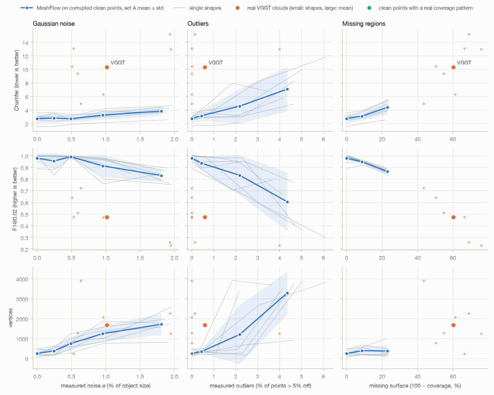

# MeshFlow robustness and better points without a GPU (Experiments A and B)

Fahad Qaseem Khawar, 7 to 8 Nov 2026. Tables and figures are regenerated by `scripts/robustness_report.py` after every queue step; the interpretation at the end is written by hand.

Queue: 203 of 600 jobs done (as of 2026-11-07 13:28:42).

Protocol v1 (`docs/eval_protocol.md`): MeshFlow's Chamfer and Hausdorff (x100, GT scaled to [-0.5, 0.5]), normal consistency, F1 at 0.01 and 0.02 of the object size, vertex count, size = mesh extent / GT extent. Clouds reach the GT frame only through the render cameras. Set A = 7 original shapes, set B = 12 new shapes (clean test set); pencilpot is the dev shape and is in no mean.

## A1. What the real VGGT clouds look like (set A)

The same statistics for every cloud (`src/photo2mesh/eval/robustness.py`), in % of the object size L. Visible = share of the GT surface the 8 cameras can see at all (from the vis8 run).

| shape | points | noise σ (% of L) | bias (% of L) | outliers (%) | coverage (%) | visible from rig (%) |
|---|---:|---:|---:|---:|---:|---:|
| cylinder_472094 | 172,890 | 0.64 | -0.25 | 0.0 | 56.5 | - |
| shackbot_94155 | 185,642 | 1.94 | 0.47 | 0.1 | 31.1 | - |
| nsphere_186199 | 97,891 | 1.95 | 0.36 | 4.0 | 24.1 | - |
| wheel_76903 | 200,000 | 0.59 | 0.35 | 0.0 | 45.3 | - |
| presents_98021 | 200,000 | 0.53 | 0.79 | 0.0 | 33.6 | - |
| monsterring_1356640 | 200,000 | 0.51 | 0.11 | 0.0 | 49.7 | - |
| cryptex_105686 | 200,000 | 0.96 | 0.41 | 0.0 | 38.8 | - |
| **mean ± std** | 179,489 ± 37,467 | 1.02 ± 0.65 | 0.32 ± 0.32 | 0.6 ± 1.5 | 39.9 ± 11.3 | - |

## A2. MeshFlow on corrupted clean points (set A)

Corruptions of the 200k clean GT samples (`scripts/corrupt_points.py`); MeshFlow seed 42; mean ± std over the 7 shapes. Nominal = what was applied; measured = the statistic of the corrupted cloud (uniform outliers that land within 5% of the surface do not count as outliers).

| input | nominal | measured | Chamfer | Hausdorff | NC | F1@0.01 | F1@0.02 | #V | size |
|---|---:|---:|---:|---:|---:|---:|---:|---:|---:|
| clean GT points (upper bound) | - | - | 2.74 ± 0.63 | 4.2 ± 1.1 | 0.908 ± 0.102 | 0.815 ± 0.149 | 0.979 ± 0.040 | 256 ± 162 | 1.02 ± 0.01 |
| noise σ 0.25% | 0.25% | 0.25% | 2.82 ± 0.70 | 4.4 ± 1.2 | 0.909 ± 0.090 | 0.792 ± 0.180 | 0.955 ± 0.069 | 381 ± 201 | 1.02 ± 0.01 |
| noise σ 0.5% | 0.5% | 0.49% | 2.71 ± 0.47 | 4.3 ± 0.5 | 0.904 ± 0.080 | 0.850 ± 0.065 | 0.991 ± 0.007 | 748 ± 326 | 1.04 ± 0.02 |
| noise σ 1% | 1% | 0.95% | 3.25 ± 0.67 | 5.7 ± 1.2 | 0.859 ± 0.102 | 0.663 ± 0.133 | 0.913 ± 0.093 | 1,247 ± 398 | 1.05 ± 0.02 |
| noise σ 2% | 2% | 1.81% | 3.84 ± 0.70 | 7.4 ± 1.3 | 0.697 ± 0.136 | 0.524 ± 0.103 | 0.830 ± 0.052 | 1,718 ± 533 | 1.09 ± 0.03 |
| outliers 1% | 1% | 0.44% | 3.15 ± 0.74 | 12.3 ± 10.9 | 0.881 ± 0.135 | 0.686 ± 0.157 | 0.936 ± 0.060 | 348 ± 96 | 1.03 ± 0.03 |
| outliers 5% | 5% | 2.18% | 4.57 ± 2.55 | 26.2 ± 11.6 | 0.813 ± 0.184 | 0.626 ± 0.254 | 0.832 ± 0.173 | 1,203 ± 1,483 | 1.03 ± 0.01 |
| outliers 10% | 10% | 4.35% | 7.08 ± 3.26 | 24.7 ± 9.5 | 0.629 ± 0.146 | 0.421 ± 0.275 | 0.605 ± 0.250 | 3,293 ± 1,067 | 1.04 ± 0.02 |
| missing 10% | 10% | 8.76% | 3.11 ± 0.65 | 13.7 ± 3.2 | 0.919 ± 0.073 | 0.775 ± 0.085 | 0.948 ± 0.014 | 391 ± 208 | 1.01 ± 0.02 |
| missing 25% | 25% | 23.09% | 4.41 ± 1.05 | 21.2 ± 5.6 | 0.902 ± 0.089 | 0.677 ± 0.127 | 0.865 ± 0.022 | 375 ± 298 | 1.00 ± 0.02 |
| missing 50% | 50% | - | - | - | - | - | - | - | - |
| **real VGGT cloud (pipeline)** | - | see A1 | 10.32 ± 3.73 | 28.0 ± 9.9 | 0.769 ± 0.071 | 0.298 ± 0.154 | 0.473 ± 0.181 | 1,682 ± 1,202 | 1.05 ± 0.02 |

## Dev shape (pencilpot): shown, never in a mean

Pencilpot tuned the point filters (earlier) and the TSDF settings (this block).

| input | Chamfer | Hausdorff | NC | F1@0.01 | F1@0.02 | #V | size | coverage (%) |
|---|---:|---:|---:|---:|---:|---:|---:|---:|
| filtered points (current) | 10.25 | 31.2 | 0.776 | 0.148 | 0.305 | 918 | 1.08 | 28.8 |
| relaxed points (no multi-view filter) | 8.44 | 30.6 | 0.787 | 0.202 | 0.429 | 2,687 | 1.18 | 71.7 |
| TSDF fusion of the depth maps | 7.05 | 26.8 | 0.849 | 0.259 | 0.509 | 804 | 1.06 | 72.3 |
| upper bound: clean GT points | 3.19 | 5.1 | 0.955 | 0.820 | 0.991 | 361 | 1.02 | 100.0 |
| point head (VGGT focal) | 12.61 | 33.9 | 0.826 | 0.068 | 0.170 | 1,785 | 1.10 | - |
| depth unprojection (VGGT focal) | 12.50 | 32.7 | 0.792 | 0.047 | 0.157 | 2,369 | 1.10 | - |

## Per shape (Chamfer / F1@0.02 of the MeshFlow mesh)

| shape | clean | noise0.25 | noise0.5 | noise1 | noise2 | out1 | out5 | out10 | miss10 | miss25 | miss50 | vis8 | vmask | vmask_noise | VGGT | relaxed | TSDF | point head |
|---|---:|---:|---:|---:|---:|---:|---:|---:|---:|---:|---:|---:|---:|---:|---:|---:|---:|---:|
| cylinder_472094 | 1.55 / 1.00 | 1.59 / 1.00 | 1.88 / 0.99 | 2.16 / 0.97 | 2.57 / 0.89 | 1.74 / 1.00 | 1.70 / 0.99 | 2.14 / 0.94 | 1.98 / 0.97 | 2.53 / 0.90 |  |  |  |  | 4.94 / 0.72 |  |  |  |
| shackbot_94155 | 3.04 / 0.99 | 3.06 / 0.99 | 3.15 / 0.99 | 4.20 / 0.80 | 4.63 / 0.75 | 3.20 / 0.99 | 8.18 / 0.60 | 11.83 / 0.29 | 3.78 / 0.95 | 5.56 / 0.85 |  |  |  |  | 15.16 / 0.26 |  |  |  |
| nsphere_186199 | 2.49 / 0.99 | 2.39 / 1.00 | 2.50 / 0.99 | 3.83 / 0.76 | 3.61 / 0.85 | 2.96 / 0.89 | 3.14 / 0.95 | 4.86 / 0.77 | 2.77 / 0.95 | 3.89 / 0.88 |  |  |  |  | 12.94 / 0.23 |  |  |  |
| wheel_76903 | 2.62 / 1.00 | 2.74 / 1.00 | 2.82 / 1.00 | 3.11 / 0.97 | 4.29 / 0.76 | 2.86 / 0.99 | 3.00 / 0.98 | 8.32 / 0.41 | 3.26 / 0.95 | 4.87 / 0.85 |  |  |  |  | 9.39 / 0.51 |  |  |  |
| presents_98021 | 3.60 / 0.89 | 3.64 / 0.88 | 3.32 / 0.98 | 3.51 / 0.96 | 4.44 / 0.84 | 3.88 / 0.84 | 4.86 / 0.65 | 9.98 / 0.36 | 3.92 / 0.92 | 5.45 / 0.84 |  |  |  |  | 13.07 / 0.47 |  |  |  |
| monsterring_1356640 | 2.95 / 1.00 | 3.52 / 0.83 | 2.56 / 1.00 | 2.95 / 0.98 | 3.64 / 0.87 | 3.59 / 0.94 | 3.20 / 0.95 | 5.78 / 0.66 | 3.11 / 0.96 | 4.51 / 0.88 |  |  |  |  | 10.44 / 0.64 |  |  |  |
| cryptex_105686 | 2.96 / 0.98 | 2.82 / 0.98 | 2.77 / 0.98 | 3.01 / 0.95 | 3.69 / 0.85 | 3.85 / 0.90 | 7.95 / 0.71 | 6.62 / 0.79 | 2.96 / 0.94 | 4.03 / 0.85 |  |  |  |  | 6.32 / 0.47 |  |  |  |
| thingi_1146183 (B) | 2.38 / 1.00 |  |  |  |  |  |  |  |  |  |  |  |  |  | 11.42 / 0.60 |  |  |  |
| thingi_84620 (B) | 2.69 / 0.99 |  |  |  |  |  |  |  |  |  |  |  |  |  | 7.46 / 0.44 |  |  |  |
| thingi_77949 (B) | 3.41 / 0.94 |  |  |  |  |  |  |  |  |  |  |  |  |  | 6.66 / 0.32 |  |  |  |
| thingi_593381 (B) | 3.50 / 1.00 |  |  |  |  |  |  |  |  |  |  |  |  |  | 13.41 / 0.24 |  |  |  |
| thingi_73155 (B) | 2.10 / 1.00 |  |  |  |  |  |  |  |  |  |  |  |  |  | 5.76 / 0.72 |  |  |  |
| thingi_40550 (B) | 2.88 / 0.99 |  |  |  |  |  |  |  |  |  |  |  |  |  | 8.53 / 0.44 |  |  |  |
| thingi_290506 (B) | 2.43 / 0.99 |  |  |  |  |  |  |  |  |  |  |  |  |  | 6.79 / 0.54 |  |  |  |
| thingi_105924 (B) | 3.61 / 0.97 |  |  |  |  |  |  |  |  |  |  |  |  |  | 11.24 / 0.42 |  |  |  |
| thingi_103356 (B) | 3.43 / 0.92 |  |  |  |  |  |  |  |  |  |  |  |  |  | 14.67 / 0.26 |  |  |  |
| thingi_59706 (B) | 2.66 / 0.99 |  |  |  |  |  |  |  |  |  |  |  |  |  | 9.29 / 0.42 |  |  |  |
| thingi_697228 (B) | 3.37 / 0.98 |  |  |  |  |  |  |  |  |  |  |  |  |  | 12.53 / 0.34 |  |  |  |
| thingi_94668 (B) | 2.66 / 0.99 |  |  |  |  |  |  |  |  |  |  |  |  |  | 7.26 / 0.49 |  |  |  |

<!-- manual -->
## Interpretation

(written when the queue has finished)
