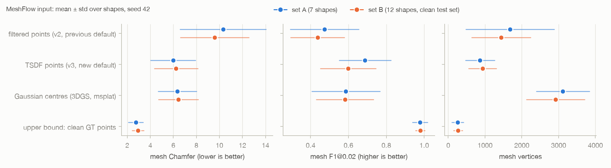

# Points stage v3 (TSDF default) and Gaussian centres as MeshFlow input

Fahad Qaseem Khawar, 9 Nov 2026. Tables and figures regenerated by `scripts/v3_report.py`; the interpretation at the end is written by hand. Protocol v1 (`docs/eval_protocol.md`). Set A = 7 original shapes, set B = 12 new shapes (clean test set); pencilpot is the dev shape and is in no mean.

Queue headline: 135 of 135 jobs ok.
Queue gaussians: 114 of 114 jobs ok.

## 1. Headline with the new default points stage (TSDF fusion)

Same 8 VGGT views and known focal; the v3 points stage fuses the depth maps in a TSDF (`configs/default.yaml` points.tsdf) instead of concatenating filtered per-view points. MeshFlow seed 42; v2 = the previous default, kept as the comparison row (its numbers are from 7 Nov).

**Set B (12 shapes, clean test set)**

| stage | Chamfer | Hausdorff | NC | F1@0.01 | F1@0.02 | #V | size |
|---|---:|---:|---:|---:|---:|---:|---:|
| pipeline mesh, v3 TSDF points | 6.24 ± 1.87 | 22.7 ± 10.3 | 0.819 ± 0.039 | 0.335 ± 0.131 | 0.598 ± 0.146 | 933 ± 379 | 1.09 ± 0.04 |
| pipeline mesh, v2 filtered points | 9.58 ± 2.98 | 29.1 ± 11.0 | 0.806 ± 0.044 | 0.235 ± 0.099 | 0.436 ± 0.141 | 1,440 ± 799 | 1.06 ± 0.03 |
| upper bound: clean GT points | 2.93 ± 0.51 | 4.4 ± 0.8 | 0.941 ± 0.031 | 0.746 ± 0.190 | 0.979 ± 0.025 | 265 ± 124 | 1.01 ± 0.02 |

Paired per shape, v3 minus v2: Chamfer -3.34 ± 1.8 (better on 12 of 12); F1@0.02 +0.162 ± 0.073 (better on 12 of 12).

**Set A (7 shapes)**

| stage | Chamfer | Hausdorff | NC | F1@0.01 | F1@0.02 | #V | size |
|---|---:|---:|---:|---:|---:|---:|---:|
| pipeline mesh, v3 TSDF points | 5.98 ± 1.94 | 22.0 ± 9.8 | 0.812 ± 0.083 | 0.386 ± 0.095 | 0.688 ± 0.136 | 864 ± 395 | 1.08 ± 0.04 |
| pipeline mesh, v2 filtered points | 10.32 ± 3.73 | 28.0 ± 9.9 | 0.769 ± 0.071 | 0.298 ± 0.154 | 0.473 ± 0.181 | 1,682 ± 1,202 | 1.05 ± 0.02 |
| upper bound: clean GT points | 2.74 ± 0.63 | 4.2 ± 1.1 | 0.908 ± 0.102 | 0.815 ± 0.149 | 0.979 ± 0.040 | 256 ± 162 | 1.02 ± 0.01 |

Paired per shape, v3 minus v2: Chamfer -4.34 ± 2.3 (better on 7 of 7); F1@0.02 +0.215 ± 0.12 (better on 6 of 7).

**Set A, mean of 3 MeshFlow seeds (42, 7, 123)**

| stage | Chamfer | Hausdorff | NC | F1@0.01 | F1@0.02 | #V | size |
|---|---:|---:|---:|---:|---:|---:|---:|
| v3 TSDF points | 5.83 ± 1.96 | 22.0 ± 9.8 | 0.809 ± 0.084 | 0.427 ± 0.113 | 0.709 ± 0.141 | 740 ± 392 | 1.07 ± 0.04 |
| v2 filtered points | 10.23 ± 3.53 | 28.5 ± 9.3 | 0.784 ± 0.074 | 0.333 ± 0.168 | 0.491 ± 0.176 | 1,594 ± 1,061 | 1.04 ± 0.02 |

Dev pencilpot (not in means), v3: Chamfer 7.12, F1@0.02 0.510, #V 982 (v2: 10.25, 0.305, 918).

## 2. Gaussian centres vs TSDF points vs filtered points (MeshFlow input)

Gaussian centres: 3D Gaussian splatting trained on the 8 views with msplat (Metal, on the Mac), in VGGT's frame with VGGT's cameras (known focal), initialised from 100k points of the v3 cloud, white background, 7,000 iterations; the centres of Gaussians with opacity >= 0.5 and largest axis <= 5% of the object are the points (settings chosen on pencilpot only; msplat training is not bit-reproducible: the same settings gave 16.0k and 16.2k Gaussians). All three inputs come from the same VGGT pass. MeshFlow seed 42.

**Set B (12 shapes, clean test set): points**

| input | points | noise σ (% of L) | bias (% of L) | outliers (%) | coverage (%) | points Chamfer | points F1@0.02 |
|---|---:|---:|---:|---:|---:|---:|---:|
| filtered points (v2, previous default) | 185,630 ± 24,649 | 1.04 ± 0.66 | 0.57 ± 0.41 | 0.3 ± 0.6 | 42.9 ± 16.1 | 8.37 ± 3.03 | 0.560 ± 0.150 |
| TSDF points (v3, new default) | 200,000 ± 0 | 1.22 ± 0.57 | 0.69 ± 0.63 | 1.7 ± 1.8 | 76.2 ± 9.4 | 5.61 ± 1.79 | 0.708 ± 0.159 |
| Gaussian centres (3DGS, msplat) | 11,480 ± 2,059 | 1.71 ± 0.55 | -0.64 ± 0.34 | 3.5 ± 3.3 | 49.7 ± 8.2 | 5.74 ± 1.41 | 0.608 ± 0.110 |

**Set B (12 shapes, clean test set): meshes**

| input | Chamfer | Hausdorff | NC | F1@0.01 | F1@0.02 | #V | size |
|---|---:|---:|---:|---:|---:|---:|---:|
| filtered points (v2, previous default) | 9.58 ± 2.98 | 29.1 ± 11.0 | 0.806 ± 0.044 | 0.235 ± 0.099 | 0.436 ± 0.141 | 1,440 ± 799 | 1.06 ± 0.03 |
| TSDF points (v3, new default) | 6.24 ± 1.87 | 22.7 ± 10.3 | 0.819 ± 0.039 | 0.335 ± 0.131 | 0.598 ± 0.146 | 933 ± 379 | 1.09 ± 0.04 |
| Gaussian centres (3DGS, msplat) | 6.44 ± 1.73 | 24.1 ± 11.3 | 0.736 ± 0.038 | 0.321 ± 0.099 | 0.581 ± 0.151 | 2,920 ± 792 | 1.16 ± 0.14 |
| upper bound: clean GT points | 2.93 ± 0.51 | 4.4 ± 0.8 | 0.941 ± 0.031 | 0.746 ± 0.190 | 0.979 ± 0.025 | 265 ± 124 | 1.01 ± 0.02 |

Paired per shape, Gaussian centres minus TSDF points: Chamfer +0.196 ± 1 (better on 4 of 12); F1@0.02 -0.0168 ± 0.14 (better on 6 of 12). Gaussian centres minus filtered points: Chamfer -3.15 ± 2.1 (better on 11 of 12).

**Set A (7 shapes): points**

| input | points | noise σ (% of L) | bias (% of L) | outliers (%) | coverage (%) | points Chamfer | points F1@0.02 |
|---|---:|---:|---:|---:|---:|---:|---:|
| filtered points (v2, previous default) | 179,489 ± 37,467 | 1.02 ± 0.65 | 0.32 ± 0.32 | 0.6 ± 1.5 | 39.9 ± 11.3 | 9.32 ± 3.46 | 0.559 ± 0.153 |
| TSDF points (v3, new default) | 200,000 ± 0 | 1.50 ± 0.95 | 0.49 ± 0.40 | 3.4 ± 7.7 | 76.9 ± 9.2 | 5.58 ± 1.93 | 0.751 ± 0.149 |
| Gaussian centres (3DGS, msplat) | 12,735 ± 4,159 | 1.85 ± 0.99 | -0.41 ± 0.57 | 4.9 ± 7.9 | 52.2 ± 16.7 | 6.00 ± 1.88 | 0.612 ± 0.189 |

**Set A (7 shapes): meshes**

| input | Chamfer | Hausdorff | NC | F1@0.01 | F1@0.02 | #V | size |
|---|---:|---:|---:|---:|---:|---:|---:|
| filtered points (v2, previous default) | 10.32 ± 3.73 | 28.0 ± 9.9 | 0.769 ± 0.071 | 0.298 ± 0.154 | 0.473 ± 0.181 | 1,682 ± 1,202 | 1.05 ± 0.02 |
| TSDF points (v3, new default) | 5.98 ± 1.94 | 22.0 ± 9.8 | 0.812 ± 0.083 | 0.386 ± 0.095 | 0.688 ± 0.136 | 864 ± 395 | 1.08 ± 0.04 |
| Gaussian centres (3DGS, msplat) | 6.34 ± 1.66 | 21.7 ± 8.3 | 0.706 ± 0.065 | 0.331 ± 0.139 | 0.586 ± 0.180 | 3,116 ± 718 | 1.16 ± 0.20 |
| upper bound: clean GT points | 2.74 ± 0.63 | 4.2 ± 1.1 | 0.908 ± 0.102 | 0.815 ± 0.149 | 0.979 ± 0.040 | 256 ± 162 | 1.02 ± 0.01 |

Paired per shape, Gaussian centres minus TSDF points: Chamfer +0.358 ± 1.3 (better on 1 of 7); F1@0.02 -0.101 ± 0.15 (better on 2 of 7). Gaussian centres minus filtered points: Chamfer -3.99 ± 2.5 (better on 6 of 7).

Training (msplat, 7000 iterations, M4 Pro): 10 ± 1 s per object, 26,063 Gaussians, 11,942 centres kept, peak memory 0.6 GB (n=19).

**Per shape (mesh Chamfer / F1@0.02)**

| shape | filtered | TSDF | Gaussian centres |
|---|---:|---:|---:|
| pencilpot_299291 (dev) | 10.25 / 0.30 | 7.12 / 0.51 | 6.91 / 0.60 |
| cylinder_472094 | 4.94 / 0.72 | 3.99 / 0.69 | 5.58 / 0.42 |
| shackbot_94155 | 15.16 / 0.26 | 8.99 / 0.53 | 9.23 / 0.38 |
| nsphere_186199 | 12.94 / 0.23 | 8.04 / 0.49 | 6.15 / 0.56 |
| wheel_76903 | 9.39 / 0.51 | 5.20 / 0.84 | 5.45 / 0.74 |
| presents_98021 | 13.07 / 0.47 | 5.35 / 0.72 | 7.38 / 0.44 |
| monsterring_1356640 | 10.44 / 0.64 | 6.36 / 0.83 | 6.60 / 0.77 |
| cryptex_105686 | 6.32 / 0.47 | 3.93 / 0.72 | 3.98 / 0.79 |
| thingi_1146183 (B) | 11.42 / 0.60 | 9.37 / 0.66 | 8.44 / 0.67 |
| thingi_84620 (B) | 7.46 / 0.44 | 4.89 / 0.69 | 4.89 / 0.71 |
| thingi_77949 (B) | 6.66 / 0.32 | 6.00 / 0.36 | 7.32 / 0.42 |
| thingi_593381 (B) | 13.41 / 0.24 | 8.46 / 0.43 | 7.83 / 0.42 |
| thingi_73155 (B) | 5.76 / 0.72 | 4.20 / 0.81 | 4.36 / 0.80 |
| thingi_40550 (B) | 8.53 / 0.44 | 4.65 / 0.66 | 4.93 / 0.67 |
| thingi_290506 (B) | 6.79 / 0.54 | 4.50 / 0.75 | 4.98 / 0.67 |
| thingi_105924 (B) | 11.24 / 0.42 | 5.28 / 0.61 | 5.96 / 0.49 |
| thingi_103356 (B) | 14.67 / 0.26 | 9.23 / 0.36 | 7.79 / 0.60 |
| thingi_59706 (B) | 9.29 / 0.42 | 5.41 / 0.57 | 5.29 / 0.68 |
| thingi_697228 (B) | 12.53 / 0.34 | 7.39 / 0.60 | 9.77 / 0.28 |
| thingi_94668 (B) | 7.26 / 0.49 | 5.52 / 0.68 | 5.67 / 0.57 |

<!-- manual -->
## Interpretation

Queues: headline 135/135 jobs ok (00:26 to 01:16), Gaussians 114/114 ok (01:21 to 01:45). Every v3 cloud was
byte-identical to the 7 Nov TSDF run (`cmp` per shape), so the v3 headline equals the robustness numbers.

**1. New headline (TSDF fusion, the default since 9 Nov).** Set B (clean test set): Chamfer 6.24 ± 1.87, NC 0.819,
F1@0.02 0.598, 933 vertices (v2 filtered points: 9.58, 0.806, 0.436, 1,440); better on 12 of 12 shapes. Set A: 5.98
(3-seed mean 5.83) vs 10.32 (10.23). The size bias is unchanged (1.08 to 1.09): it comes from noise via MeshFlow
(robustness report), not from coverage.

**2. Gaussian centres vs TSDF points vs filtered points.**
- Gaussian centres are much better than the old filtered points (set B Chamfer 6.44 vs 9.58, better on 11 of 12)
  because, like TSDF, they keep coverage (raw coverage within 5% of L: 0.83 to 0.87 on pencilpot).
- Against TSDF points they are not better: set B Chamfer 6.44 vs 6.24 (better on 4 of 12), F1@0.02 0.581 vs 0.598
  (6 of 12); set A 6.34 vs 5.98 (1 of 7). The Chamfer difference is within the shape-to-shape spread.
- They are clearly worse on surface quality: NC 0.736 vs 0.819, about 3 times the vertices (2,920 vs 933) and larger
  meshes (size 1.16 vs 1.09). Gaussian centres sit about 0.5% of L inside the surface (bias -0.64% vs +0.69%), are
  noisier (σ 1.7% vs 1.2%) and sparser (about 12k centres; the coverage statistic at 1% under-counts sparse clouds).
  Noise, not coverage, drives vertices and size (robustness report), which fits.
- Practical: msplat trains one object in about 10 s with 0.6 GB on the M4 Pro (8 views at 518 px, 7,000 iterations).
  Training is not bit-reproducible; settings (100k initial points from the v3 cloud, opacity >= 0.5) were chosen on
  pencilpot only, by mesh F1.

**Decision suggested by the data:** keep TSDF fusion as the points stage. Gaussian centres are a viable alternative
input (same Chamfer, no GPU needed) but give MeshFlow noisier points, hence lower NC and 3 times the vertices. If
Gaussians are used later, it should be for what they add beyond centres (opacity, scale, colour for the render-back
loop), not as a replacement point source.

**Caveats.** One MeshFlow seed (42) for the Gaussian comparison; 3DGS from 8 sparse views; the Gaussians start from
the TSDF cloud, so they are not independent of it (an SfM-only start would need COLMAP features; the 20k-point start
gave a worse mesh on pencilpot: Chamfer 7.89, F1@0.02 0.40).
