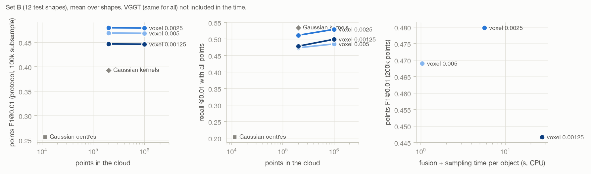

# The point cloud as the main output: TSDF density sweep and Gaussian kernel sampling

Fahad Qaseem Khawar, 12 Nov 2026. Direction from Prof. Zhong (9 Nov): points side only; dense, accurate, high-fidelity clouds; lightweight is not a priority yet. Tables and the figure are regenerated by `scripts/points_report.py`; the interpretation at the end is written by hand. Set A = 7 original shapes, set B = 12 new shapes (clean test set); pencilpot is the dev shape (all settings were chosen on it) and is in no mean. Mean ± std over shapes.

Queue: 864 of 866 jobs ok; not ok: wheel_76903_td005/same_as_v3, wheel_76903_tdraw/same_as_v3.

**How the points are scored** (protocol v1, `docs/eval_protocol.md`, MeshFlow's frame: GT bbox centre, max extent 1, i.e. [-0.5, 0.5]): cloud aligned by the camera similarity only (no ICP). Chamfer and Hausdorff x100 on 5,000 random points of the cloud vs 5,000 GT surface samples (MeshFlow protocol). F1 at 0.005, 0.01 and 0.02 and NC on 100,000 random points vs 100,000 GT samples. Because both use random subsamples, a denser cloud of the same surface scores the same there; the **all-points recall** (share of the 100k GT samples within tau of any point of the cloud) is what extra density can buy. **Coverage**: share of the GT surface within 1% of the footprint of the cloud's inliers (points within 5% of the surface, projected onto it), as in the robustness report. F1@0.005 and the all-points recall are new (added 12 Nov).

## 1. Points first: every points stage scored against the GT

**Set B (12 shapes, clean test set)**

| points stage | Chamfer | Hausdorff | F1@0.005 | F1@0.01 | F1@0.02 | NC | coverage (%) | #points |
|---|---:|---:|---:|---:|---:|---:|---:|---:|
| filtered points (v2, previous default) | 8.37 ± 3.03 | 27.6 ± 11.7 | 0.207 ± 0.111 | 0.379 ± 0.166 | 0.560 ± 0.150 | 0.810 ± 0.031 | 42.9 ± 16.1 | 185,630 ± 24,649 |
| TSDF points (v3, default) | 5.61 ± 1.79 | 21.7 ± 9.5 | 0.235 ± 0.154 | 0.469 ± 0.203 | 0.708 ± 0.159 | 0.809 ± 0.026 | 76.2 ± 9.4 | 200,000 ± 0 |
| Gaussian centres | 5.74 ± 1.41 | 25.7 ± 9.7 | 0.061 ± 0.026 | 0.256 ± 0.075 | 0.608 ± 0.110 | 0.769 ± 0.042 | 49.7 ± 8.2 | 11,480 ± 2,059 |
| Gaussian kernels, opacity-weighted | 5.80 ± 1.39 | 26.0 ± 9.4 | 0.160 ± 0.053 | 0.393 ± 0.086 | 0.680 ± 0.097 | 0.761 ± 0.043 | 79.6 ± 6.9 | 200,000 ± 0 |
| Gaussian kernels, opacity x area | 5.83 ± 1.20 | 25.6 ± 7.6 | 0.143 ± 0.040 | 0.362 ± 0.064 | 0.644 ± 0.077 | 0.770 ± 0.043 | 82.7 ± 6.3 | 200,000 ± 0 |

Paired per shape: Gaussian kernels minus TSDF, F1@0.01 -0.0761 ± 0.15 (better on 4 of 12), Chamfer +0.195 ± 0.6 (better on 3 of 12); Gaussian kernels minus Gaussian centres, F1@0.01 +0.137 ± 0.015 (better on 12 of 12).

**Set A (7 shapes)**

| points stage | Chamfer | Hausdorff | F1@0.005 | F1@0.01 | F1@0.02 | NC | coverage (%) | #points |
|---|---:|---:|---:|---:|---:|---:|---:|---:|
| filtered points (v2, previous default) | 9.32 ± 3.46 | 27.1 ± 10.6 | 0.245 ± 0.143 | 0.414 ± 0.181 | 0.559 ± 0.153 | 0.800 ± 0.051 | 39.9 ± 11.3 | 179,489 ± 37,467 |
| TSDF points (v3, default) | 5.58 ± 1.93 | 22.0 ± 10.1 | 0.251 ± 0.141 | 0.515 ± 0.188 | 0.751 ± 0.149 | 0.803 ± 0.064 | 76.9 ± 9.2 | 200,000 ± 0 |
| Gaussian centres | 6.00 ± 1.88 | 30.3 ± 14.5 | 0.076 ± 0.040 | 0.281 ± 0.124 | 0.612 ± 0.189 | 0.748 ± 0.080 | 52.2 ± 16.7 | 12,735 ± 4,159 |
| Gaussian kernels, opacity-weighted | 6.05 ± 1.88 | 32.0 ± 18.8 | 0.169 ± 0.061 | 0.405 ± 0.133 | 0.685 ± 0.160 | 0.741 ± 0.078 | 77.7 ± 13.2 | 200,000 ± 0 |
| Gaussian kernels, opacity x area | 6.16 ± 1.82 | 30.0 ± 18.4 | 0.150 ± 0.057 | 0.371 ± 0.123 | 0.644 ± 0.152 | 0.750 ± 0.076 | 80.5 ± 11.9 | 200,000 ± 0 |

Paired per shape: Gaussian kernels minus TSDF, F1@0.01 -0.11 ± 0.12 (better on 1 of 7), Chamfer +0.469 ± 0.33 (better on 0 of 7); Gaussian kernels minus Gaussian centres, F1@0.01 +0.124 ± 0.024 (better on 7 of 7).

## 2. TSDF density sweep

Same VGGT pass (8 views, known focal) per shape; the TSDF voxel is a fraction of the object size (bbox of the fused pixels, 1st to 99th percentile), truncation 6 voxels, and n points are sampled from the fused surface (area-uniform). 0.005 / 200k is the v3 default (the sweep reproduces it byte for byte, job `same_as_v3`). Time = fusion + small-piece removal + sampling, CPU, per object; peak = largest resident memory of the fusion process over the shapes.

**Set B (12 shapes, clean test set)**

| voxel (x object size) | points | Chamfer | Hausdorff | F1@0.005 | F1@0.01 | F1@0.02 | NC | recall, all points @0.005 | recall, all points @0.01 | coverage (%) | time (s) | peak (GB) |
|---|---:|---:|---:|---:|---:|---:|---:|---:|---:|---:|---:|---:|
| 0.005 (current) | 200k | 5.61 ± 1.79 | 21.7 ± 9.5 | 0.235 ± 0.154 | 0.469 ± 0.203 | 0.708 ± 0.159 | 0.809 ± 0.026 | 0.262 ± 0.144 | 0.473 ± 0.180 | 76.2 ± 9.4 | 1.0 ± 0.3 | 1.3 |
| 0.005 (current) | 1M | 5.59 ± 1.80 | 21.7 ± 9.7 | 0.234 ± 0.154 | 0.469 ± 0.204 | 0.708 ± 0.160 | 0.809 ± 0.026 | 0.287 ± 0.143 | 0.485 ± 0.177 | 76.5 ± 9.4 | 1.3 ± 0.3 | 1.4 |
| 0.0025 (2x finer) | 200k | 5.62 ± 1.78 | 21.3 ± 9.9 | 0.236 ± 0.136 | 0.480 ± 0.195 | 0.709 ± 0.162 | 0.754 ± 0.029 | 0.301 ± 0.150 | 0.511 ± 0.180 | 76.1 ± 9.3 | 5.7 ± 1.7 | 4.4 |
| 0.0025 (2x finer) | 1M | 5.60 ± 1.80 | 21.2 ± 9.8 | 0.236 ± 0.136 | 0.479 ± 0.195 | 0.708 ± 0.163 | 0.754 ± 0.029 | 0.348 ± 0.152 | 0.529 ± 0.175 | 76.5 ± 9.4 | 6.1 ± 1.8 | 4.4 |
| 0.00125 (4x finer) | 200k | 6.01 ± 1.91 | 22.0 ± 10.4 | 0.217 ± 0.132 | 0.447 ± 0.194 | 0.675 ± 0.174 | 0.708 ± 0.031 | 0.280 ± 0.147 | 0.478 ± 0.179 | 73.8 ± 9.6 | 27.3 ± 6.9 | 12.7 |
| 0.00125 (4x finer) | 1M | 6.00 ± 1.88 | 21.9 ± 10.2 | 0.218 ± 0.132 | 0.446 ± 0.194 | 0.676 ± 0.174 | 0.707 ± 0.030 | 0.331 ± 0.153 | 0.499 ± 0.176 | 74.3 ± 9.7 | 27.4 ± 7.0 | 14.1 |

VGGT itself (MPS, 8 views): 19 ± 1 s per object, the same for every row.

**Set A (7 shapes)**

| voxel (x object size) | points | Chamfer | Hausdorff | F1@0.005 | F1@0.01 | F1@0.02 | NC | recall, all points @0.005 | recall, all points @0.01 | coverage (%) | time (s) | peak (GB) |
|---|---:|---:|---:|---:|---:|---:|---:|---:|---:|---:|---:|---:|
| 0.005 (current) | 200k | 5.58 ± 1.93 | 22.0 ± 10.1 | 0.251 ± 0.141 | 0.515 ± 0.188 | 0.751 ± 0.149 | 0.803 ± 0.064 | 0.288 ± 0.118 | 0.520 ± 0.129 | 76.9 ± 9.2 | 1.0 ± 0.3 | 1.3 |
| 0.005 (current) | 1M | 5.56 ± 1.91 | 22.0 ± 10.1 | 0.252 ± 0.141 | 0.516 ± 0.188 | 0.751 ± 0.149 | 0.801 ± 0.063 | 0.319 ± 0.115 | 0.532 ± 0.125 | 77.4 ± 9.2 | 1.2 ± 0.3 | 1.5 |
| 0.0025 (2x finer) | 200k | 5.73 ± 2.22 | 17.7 ± 8.9 | 0.249 ± 0.133 | 0.516 ± 0.198 | 0.737 ± 0.169 | 0.763 ± 0.056 | 0.305 ± 0.114 | 0.545 ± 0.133 | 76.5 ± 10.3 | 4.7 ± 1.8 | 3.8 |
| 0.0025 (2x finer) | 1M | 5.72 ± 2.22 | 17.6 ± 8.8 | 0.250 ± 0.133 | 0.516 ± 0.198 | 0.737 ± 0.169 | 0.762 ± 0.056 | 0.347 ± 0.108 | 0.562 ± 0.127 | 77.2 ± 10.3 | 5.1 ± 1.8 | 3.8 |
| 0.00125 (4x finer) | 200k | 6.10 ± 2.70 | 18.5 ± 9.1 | 0.242 ± 0.117 | 0.515 ± 0.202 | 0.731 ± 0.188 | 0.718 ± 0.041 | 0.314 ± 0.123 | 0.549 ± 0.163 | 74.0 ± 10.8 | 25.4 ± 7.6 | 13.5 |
| 0.00125 (4x finer) | 1M | 6.07 ± 2.67 | 18.2 ± 9.2 | 0.242 ± 0.117 | 0.515 ± 0.202 | 0.731 ± 0.188 | 0.719 ± 0.041 | 0.370 ± 0.125 | 0.567 ± 0.160 | 74.7 ± 10.8 | 25.9 ± 7.8 | 11.9 |

VGGT itself (MPS, 8 views): 20 ± 1 s per object, the same for every row.

## 3. MeshFlow on these clouds (secondary)

MeshFlow resamples every input to 4,096 points and voxelises them at 32^3, so it cannot see the density differences above; seed 42.

**Set B (12 shapes, clean test set)**

| MeshFlow input | Chamfer | Hausdorff | NC | F1@0.01 | F1@0.02 | #V | size |
|---|---:|---:|---:|---:|---:|---:|---:|
| TSDF points (v3, default) | 6.24 ± 1.87 | 22.7 ± 10.3 | 0.819 ± 0.039 | 0.335 ± 0.131 | 0.598 ± 0.146 | 933 ± 379 | 1.09 ± 0.04 |
| TSDF, voxel 0.0025 | 6.16 ± 1.92 | 22.0 ± 10.0 | 0.818 ± 0.043 | 0.368 ± 0.150 | 0.636 ± 0.183 | 1,408 ± 737 | 1.08 ± 0.03 |
| TSDF, voxel 0.00125 | 6.72 ± 2.12 | 23.3 ± 11.0 | 0.820 ± 0.053 | 0.348 ± 0.156 | 0.582 ± 0.188 | 1,547 ± 888 | 1.08 ± 0.02 |
| Gaussian kernels, opacity-weighted | 6.66 ± 1.25 | 22.4 ± 9.1 | 0.720 ± 0.062 | 0.298 ± 0.088 | 0.557 ± 0.135 | 2,738 ± 590 | 1.15 ± 0.13 |
| Gaussian centres | 6.44 ± 1.73 | 24.1 ± 11.3 | 0.736 ± 0.038 | 0.321 ± 0.099 | 0.581 ± 0.151 | 2,920 ± 792 | 1.16 ± 0.14 |
| filtered points (v2) | 9.58 ± 2.98 | 29.1 ± 11.0 | 0.806 ± 0.044 | 0.235 ± 0.099 | 0.436 ± 0.141 | 1,440 ± 799 | 1.06 ± 0.03 |
| upper bound: clean GT points | 2.93 ± 0.51 | 4.4 ± 0.8 | 0.941 ± 0.031 | 0.746 ± 0.190 | 0.979 ± 0.025 | 265 ± 124 | 1.01 ± 0.02 |

**Set A (7 shapes)**

| MeshFlow input | Chamfer | Hausdorff | NC | F1@0.01 | F1@0.02 | #V | size |
|---|---:|---:|---:|---:|---:|---:|---:|
| TSDF points (v3, default) | 5.98 ± 1.94 | 22.0 ± 9.8 | 0.812 ± 0.083 | 0.386 ± 0.095 | 0.688 ± 0.136 | 864 ± 395 | 1.08 ± 0.04 |
| TSDF, voxel 0.0025 | 6.26 ± 2.16 | 17.9 ± 8.4 | 0.796 ± 0.096 | 0.354 ± 0.101 | 0.654 ± 0.149 | 1,091 ± 458 | 1.08 ± 0.05 |
| TSDF, voxel 0.00125 | 6.69 ± 3.03 | 19.2 ± 9.1 | 0.811 ± 0.088 | 0.420 ± 0.175 | 0.671 ± 0.197 | 1,019 ± 538 | 1.06 ± 0.04 |
| Gaussian kernels, opacity-weighted | 7.00 ± 1.76 | 22.9 ± 9.4 | 0.706 ± 0.091 | 0.307 ± 0.149 | 0.543 ± 0.205 | 3,020 ± 896 | 1.17 ± 0.19 |
| Gaussian centres | 6.34 ± 1.66 | 21.7 ± 8.3 | 0.706 ± 0.065 | 0.331 ± 0.139 | 0.586 ± 0.180 | 3,116 ± 718 | 1.16 ± 0.20 |
| filtered points (v2) | 10.32 ± 3.73 | 28.0 ± 9.9 | 0.769 ± 0.071 | 0.298 ± 0.154 | 0.473 ± 0.181 | 1,682 ± 1,202 | 1.05 ± 0.02 |
| upper bound: clean GT points | 2.74 ± 0.63 | 4.2 ± 1.1 | 0.908 ± 0.102 | 0.815 ± 0.149 | 0.979 ± 0.040 | 256 ± 162 | 1.02 ± 0.01 |

## 4. Pilot on the dev shape (pencilpot): how the settings were chosen

| run | what | Chamfer | Hausdorff | F1@0.005 | F1@0.01 | F1@0.02 | NC | recall, all points @0.005 | recall, all points @0.01 | coverage (%) |
|---|---:|---:|---:|---:|---:|---:|---:|---:|---:|---:|
| tex_v3 | TSDF voxel 0.005, trunc 6 voxels, 200k (v3 default) | 6.21 | 23.8 | 0.123 | 0.366 | 0.715 | 0.824 | 0.154 | 0.370 | 72.2 |
| td0025 | voxel 0.0025, trunc 6 voxels | 6.23 | 23.5 | 0.128 | 0.394 | 0.712 | 0.768 | 0.174 | 0.426 | 72.5 |
| td0025t | voxel 0.0025, trunc 12 voxels (same distance) | 6.21 | 24.0 | 0.116 | 0.353 | 0.712 | 0.787 | 0.154 | 0.379 | 73.7 |
| td00125 | voxel 0.00125, trunc 6 voxels | 6.58 | 25.2 | 0.106 | 0.328 | 0.668 | 0.714 | 0.148 | 0.373 | 70.7 |
| td00125t | voxel 0.00125, trunc 24 voxels | 7.01 | 29.2 | 0.125 | 0.361 | 0.694 | 0.671 | 0.153 | 0.357 | 61.8 |
| td005n1m | voxel 0.005, 1M points | 6.19 | 23.9 | 0.124 | 0.365 | 0.715 | 0.826 | 0.179 | 0.386 | 72.7 |
| td0025n1m | voxel 0.0025, 1M points | 6.35 | 25.5 | 0.128 | 0.393 | 0.712 | 0.769 | 0.221 | 0.455 | 73.2 |
| gs | Gaussian centres | 6.16 | 22.3 | 0.052 | 0.247 | 0.601 | 0.789 | 0.033 | 0.194 | 48.9 |
| gsk | Gaussian kernels, opacity-weighted | 6.11 | 21.1 | 0.133 | 0.377 | 0.669 | 0.781 | 0.217 | 0.505 | 74.7 |
| gska | Gaussian kernels, opacity x area | 6.26 | 21.2 | 0.125 | 0.357 | 0.647 | 0.786 | 0.231 | 0.528 | 77.5 |

## 5. Per shape (points F1@0.01: TSDF v3 / TSDF voxel 0.0025 / Gaussian kernels)

| shape | TSDF v3 | TSDF 0.0025 | Gaussian kernels |
|---|---:|---:|---:|
| cylinder_472094 | 0.468 | 0.486 | 0.356 |
| shackbot_94155 | 0.347 | 0.311 | 0.241 |
| nsphere_186199 | 0.275 | 0.261 | 0.241 |
| wheel_76903 | 0.668 | 0.663 | 0.514 |
| presents_98021 | 0.559 | 0.618 | 0.400 |
| monsterring_1356640 | 0.824 | 0.819 | 0.522 |
| cryptex_105686 | 0.466 | 0.454 | 0.563 |
| thingi_1146183 (B) | 0.589 | 0.587 | 0.365 |
| thingi_84620 (B) | 0.544 | 0.529 | 0.503 |
| thingi_77949 (B) | 0.181 | 0.174 | 0.277 |
| thingi_593381 (B) | 0.237 | 0.246 | 0.326 |
| thingi_73155 (B) | 0.784 | 0.751 | 0.537 |
| thingi_40550 (B) | 0.506 | 0.596 | 0.399 |
| thingi_290506 (B) | 0.653 | 0.647 | 0.485 |
| thingi_105924 (B) | 0.390 | 0.445 | 0.400 |
| thingi_103356 (B) | 0.138 | 0.151 | 0.368 |
| thingi_59706 (B) | 0.646 | 0.641 | 0.448 |
| thingi_697228 (B) | 0.391 | 0.441 | 0.279 |
| thingi_94668 (B) | 0.568 | 0.551 | 0.327 |

<!-- manual -->
## Interpretation

(written when the queue has finished)
