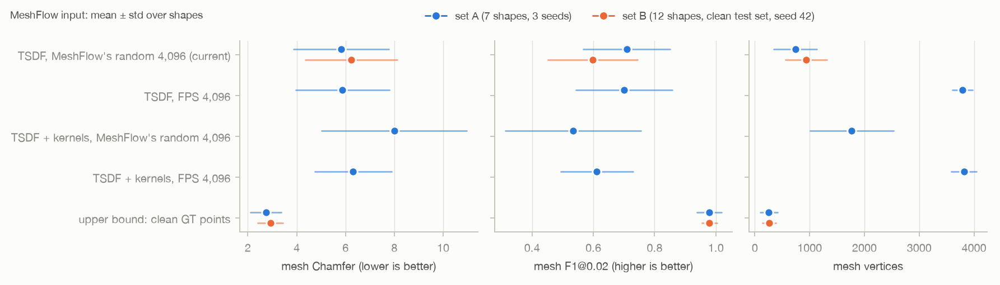

# MeshFlow input: 4,096 farthest-point-sampled points vs MeshFlow's own random pick

Fahad Qaseem Khawar, 13 Nov 2026. Tables and the figure are regenerated by `scripts/fps_report.py`; the interpretation at the end is written by hand. Protocol v1 mesh metrics (`docs/eval_protocol.md`). Set A = 7 original shapes, set B = 12 new shapes (clean test set); pencilpot is the dev shape and is in no mean.

Queue: 122 of 242 jobs ok.

**Why:** MeshFlow's network takes exactly 4,096 input points (fixed by training). Its loader normalises the cloud and keeps `torch.randperm(N)[:4096]`, a random 2% of our 200k TSDF points. Handing it exactly 4,096 points chosen by farthest-point sampling (FPS, `scripts/fps_points.py`) makes that pick a permutation, so every FPS point reaches the network. FPS spreads the points evenly over the cloud, but it also seeks out the cloud's extremes, so stray points are more likely to be kept. **Inputs** (same VGGT pass, same alignment, no rerun of points): the TSDF cloud (`_tex_v3`, 200k); the TSDF cloud plus 200k Gaussian-kernel samples (`_gsk`, opacity-weighted), a simple union of 400k points. The current random-pick rows are the existing `_tex_v3` meshes (seeds 42, 7, 123). Note that the input size changes how many random numbers the pick consumes, so the same seed gives a different generation noise across inputs; the 3 seeds on set A are what separates the input effect from that.

## 1. What MeshFlow sees

`scripts/meshflow_input_stats.py`: the 4,096 points after MeshFlow's normalisation, voxelised at 32^3 as in `voxelize_pc`, against 100k GT surface samples in the same frame (random picks reproduced on the CPU with seed 42: same distribution as MeshFlow's MPS pick, not necessarily the same points).

**Set B (12 shapes, clean test set)**

| MeshFlow input | occupied 32^3 cells | GT cells hit | cells on GT | points off surface (> 2%) | GT gap p95 (% of extent) |
|---|---:|---:|---:|---:|---:|
| TSDF, MeshFlow's random 4,096 (current) | - | - | - | - | - |
| TSDF, FPS 4,096 | - | - | - | - | - |
| TSDF + kernels, MeshFlow's random 4,096 | - | - | - | - | - |
| TSDF + kernels, FPS 4,096 | - | - | - | - | - |

**Set A (7 shapes)**

| MeshFlow input | occupied 32^3 cells | GT cells hit | cells on GT | points off surface (> 2%) | GT gap p95 (% of extent) |
|---|---:|---:|---:|---:|---:|
| TSDF, MeshFlow's random 4,096 (current) | 1,611 ± 382 | 0.549 ± 0.075 | 0.754 ± 0.165 | 0.206 ± 0.205 | 12.99 ± 7.72 |
| TSDF, FPS 4,096 | 1,964 ± 520 | 0.644 ± 0.078 | 0.738 ± 0.182 | 0.227 ± 0.221 | 12.66 ± 7.77 |
| TSDF + kernels, MeshFlow's random 4,096 | 1,558 ± 446 | 0.639 ± 0.128 | 0.702 ± 0.115 | 0.271 ± 0.191 | 11.50 ± 7.31 |
| TSDF + kernels, FPS 4,096 | 2,380 ± 663 | 0.780 ± 0.121 | 0.565 ± 0.104 | 0.457 ± 0.166 | 8.95 ± 6.64 |

## 2. Meshes, MeshFlow seed 42

**Set B (12 shapes, clean test set)**

| MeshFlow input | Chamfer | Hausdorff | NC | F1@0.01 | F1@0.02 | #V | size |
|---|---:|---:|---:|---:|---:|---:|---:|
| TSDF, MeshFlow's random 4,096 (current) | 6.24 ± 1.87 | 22.7 ± 10.3 | 0.819 ± 0.039 | 0.335 ± 0.131 | 0.598 ± 0.146 | 933 ± 379 | 1.09 ± 0.04 |
| TSDF, FPS 4,096 | - | - | - | - | - | - | - |
| TSDF + kernels, MeshFlow's random 4,096 | - | - | - | - | - | - | - |
| TSDF + kernels, FPS 4,096 | - | - | - | - | - | - | - |
| upper bound: clean GT points | 2.93 ± 0.51 | 4.4 ± 0.8 | 0.941 ± 0.031 | 0.746 ± 0.190 | 0.979 ± 0.025 | 265 ± 124 | 1.01 ± 0.02 |

Paired per shape: TSDF: FPS minus random: Chamfer -, F1@0.02 -, #V -; TSDF + kernels: FPS minus random: Chamfer -, F1@0.02 -, #V -; TSDF + kernels FPS minus TSDF random (current): Chamfer -, F1@0.02 -, #V -.

**Set A (7 shapes)**

| MeshFlow input | Chamfer | Hausdorff | NC | F1@0.01 | F1@0.02 | #V | size |
|---|---:|---:|---:|---:|---:|---:|---:|
| TSDF, MeshFlow's random 4,096 (current) | 5.98 ± 1.94 | 22.0 ± 9.8 | 0.812 ± 0.083 | 0.386 ± 0.095 | 0.688 ± 0.136 | 864 ± 395 | 1.08 ± 0.04 |
| TSDF, FPS 4,096 | 5.99 ± 1.91 | 22.2 ± 10.2 | 0.807 ± 0.073 | 0.425 ± 0.174 | 0.689 ± 0.157 | 3,839 ± 118 | 1.07 ± 0.04 |
| TSDF + kernels, MeshFlow's random 4,096 | 9.30 ± 5.95 | 24.2 ± 9.1 | 0.701 ± 0.127 | 0.302 ± 0.180 | 0.523 ± 0.262 | 1,936 ± 716 | 1.08 ± 0.06 |
| TSDF + kernels, FPS 4,096 | 6.37 ± 1.66 | 30.2 ± 17.8 | 0.698 ± 0.093 | 0.353 ± 0.119 | 0.609 ± 0.142 | 3,734 ± 294 | 1.21 ± 0.21 |
| upper bound: clean GT points | 2.74 ± 0.63 | 4.2 ± 1.1 | 0.908 ± 0.102 | 0.815 ± 0.149 | 0.979 ± 0.040 | 256 ± 162 | 1.02 ± 0.01 |

Paired per shape: TSDF: FPS minus random: Chamfer +0.00666 ± 0.28 (better on 3 of 7), F1@0.02 +0.00139 ± 0.045 (better on 3 of 7), #V +2.97e+03 ± 4.2e+02 (lower on 0 of 7); TSDF + kernels: FPS minus random: Chamfer -2.93 ± 5.7 (better on 5 of 7), F1@0.02 +0.0862 ± 0.21 (better on 4 of 7), #V +1.8e+03 ± 6.5e+02 (lower on 0 of 7); TSDF + kernels FPS minus TSDF random (current): Chamfer +0.391 ± 0.56 (better on 1 of 7), F1@0.02 -0.0788 ± 0.064 (better on 1 of 7), #V +2.87e+03 ± 3.8e+02 (lower on 0 of 7).

## 3. Set A, mean of 3 MeshFlow seeds (42, 7, 123)

Each shape's metrics are first averaged over the 3 seeds; mean ± std over the 7 shapes. Paired differences use all 21 (shape, seed) pairs.

| MeshFlow input | Chamfer | Hausdorff | NC | F1@0.01 | F1@0.02 | #V | size |
|---|---:|---:|---:|---:|---:|---:|---:|
| TSDF, MeshFlow's random 4,096 (current) | 5.83 ± 1.96 | 22.0 ± 9.8 | 0.809 ± 0.084 | 0.427 ± 0.113 | 0.709 ± 0.141 | 740 ± 392 | 1.07 ± 0.04 |
| TSDF, FPS 4,096 | 5.88 ± 1.91 | 22.0 ± 9.9 | 0.814 ± 0.073 | 0.452 ± 0.182 | 0.701 ± 0.158 | 3,786 ± 184 | 1.07 ± 0.04 |
| TSDF + kernels, MeshFlow's random 4,096 | 8.00 ± 2.97 | 22.6 ± 7.5 | 0.720 ± 0.093 | 0.316 ± 0.169 | 0.534 ± 0.222 | 1,770 ± 763 | 1.11 ± 0.07 |
| TSDF + kernels, FPS 4,096 | 6.31 ± 1.57 | 29.8 ± 17.8 | 0.711 ± 0.110 | 0.352 ± 0.097 | 0.611 ± 0.118 | 3,816 ± 226 | 1.21 ± 0.22 |

Paired: TSDF: FPS minus random: Chamfer +0.0521 ± 0.35 (better on 10 of 21), F1@0.02 -0.00778 ± 0.064 (better on 10 of 21), #V +3.05e+03 ± 6e+02 (lower on 0 of 21); TSDF + kernels: FPS minus random: Chamfer -1.69 ± 3.6 (better on 15 of 21), F1@0.02 +0.0769 ± 0.18 (better on 14 of 21), #V +2.05e+03 ± 8.2e+02 (lower on 0 of 21); TSDF + kernels FPS minus TSDF random (current): Chamfer +0.485 ± 0.56 (better on 4 of 21), F1@0.02 -0.0976 ± 0.088 (better on 3 of 21), #V +3.08e+03 ± 4.4e+02 (lower on 0 of 21).

## 4. Dev shape (pencilpot, not in means), seed 42

| MeshFlow input | Chamfer | F1@0.02 | #V |
|---|---:|---:|---:|
| TSDF, MeshFlow's random 4,096 (current) | 7.12 | 0.510 | 982 |
| TSDF, FPS 4,096 | 6.77 | 0.540 | 3,876 |
| TSDF + kernels, MeshFlow's random 4,096 | 6.70 | 0.591 | 2,272 |
| TSDF + kernels, FPS 4,096 | 6.75 | 0.551 | 3,794 |

## 5. Per shape (mesh Chamfer, seed 42)

| shape | TSDF, MeshFlow's random 4,096 (current) | TSDF, FPS 4,096 | TSDF + kernels, MeshFlow's random 4,096 | TSDF + kernels, FPS 4,096 |
|---|---:|---:|---:|---:|
| cylinder_472094 | 3.99 | 4.46 | 8.04 | 4.95 |
| shackbot_94155 | 8.99 | 8.99 | 8.66 | 9.30 |
| nsphere_186199 | 8.04 | 8.11 | 10.04 | 7.58 |
| wheel_76903 | 5.20 | 5.19 | 5.09 | 5.33 |
| presents_98021 | 5.35 | 4.87 | 22.08 | 6.50 |
| monsterring_1356640 | 6.36 | 6.29 | 6.55 | 6.41 |
| cryptex_105686 | 3.93 | 4.00 | 4.67 | 4.52 |

<!-- manual -->
## Interpretation

(written when the queue has finished)
