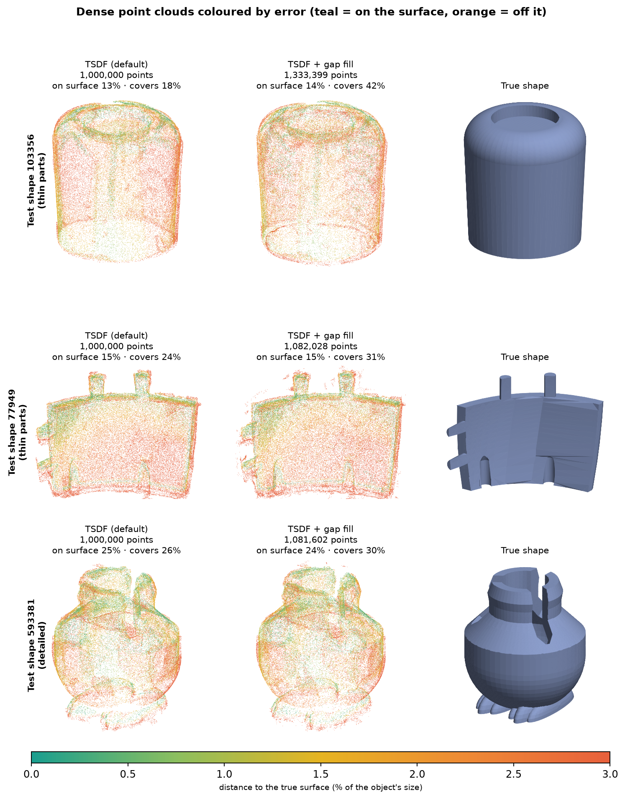

# Dense points by default, more views, MeshFlow vertex control

Fahad Qaseem Khawar, 15 Nov 2026. Tables regenerated by `scripts/dense_report.py`; the summary and the interpretation are written by hand. Set A = 7 original shapes, set B = 12 new shapes (clean test set); pencilpot is the dev shape and is in no mean. Mean ± std over shapes.

<!-- summary -->
**Summary (15 Nov).**
- **Improved:** dense output (1M points) is the default; with the Gaussian-kernel gap fill it is the best point cloud
  so far (set B: Chamfer 5.61 to 5.31, all-points recall @0.02 0.68 to 0.83, coverage 76% to 85%; F1@0.01 unchanged
  within 0.003). 12 and 16 VGGT views run safely on the laptop (no red memory pressure in 40 runs, at least 13% free)
  and raise F1@0.01 (set B 0.469 to 0.552 at 16 views), F1@0.02, NC and recall on most shapes.
- **Did not improve:** Chamfer with 16 views (set B 5.59 to 5.85, better on 5 of 12): the extra views add some far
  floaters (Hausdorff up on 11 of 12), probably because the TSDF settings (surface from a single view) were tuned for
  8 views. MeshFlow's vertex count cannot be requested: the public checkpoint has no trained `num_verts` layer.
- **Three numbers to say out loud:** (1) best cloud: Chamfer 5.31, down from 5.61; (2) it covers 85% of the true
  surface, up from 76% (recall @0.02 0.83, up from 0.68); (3) 16 views on the laptop: F1@0.01 0.55, up from 0.47.
<!-- /summary -->

Queue `dense_queue`: 200 of 200 jobs ok. Queue `views_queue`: 32 of 32 jobs ok.

## 1. Dense output is the default: 1M points at TSDF voxel 0.005

Points vs GT, protocol v1 (Chamfer x100 on 5,000 points per side; F1 and NC on 100,000), plus the all-points recall (share of 100,000 GT samples within tau of any point of the cloud; the metric that density can move). The 1M TSDF clouds are resampled from the same fused surfaces as the 200k ones (`scripts/resample_tsdf.py`, identical to the 1M sweep cells of 12 Nov, checked on thingi_59706). Gap fill: kernel samples 3-10% from the TSDF cloud (rule of 14 Nov); at 1M the kernels are sampled at 1M too.

**Set B (12 shapes, clean test set)**

| points | Chamfer | F1@0.01 | F1@0.02 | recall, all points @0.01 | recall, all points @0.02 | NC | coverage (%) | #points |
|---|---:|---:|---:|---:|---:|---:|---:|---:|
| TSDF, 200k (previous default) | 5.61 ± 1.79 | 0.469 ± 0.203 | 0.708 ± 0.159 | 0.473 ± 0.180 | 0.677 ± 0.138 | 0.809 ± 0.026 | 76.2 ± 9.4 | 200,000 ± 0 |
| TSDF, 1M (new default) | 5.59 ± 1.80 | 0.469 ± 0.204 | 0.708 ± 0.160 | 0.485 ± 0.177 | 0.682 ± 0.136 | 0.809 ± 0.026 | 76.5 ± 9.4 | 1,000,000 ± 0 |
| TSDF + gap fill, 200k base | 5.34 ± 1.53 | 0.465 ± 0.195 | 0.732 ± 0.138 | 0.513 ± 0.162 | 0.794 ± 0.097 | 0.808 ± 0.033 | 82.4 ± 8.0 | 220,453 ± 16,313 |
| TSDF + gap fill, 1M base (new best) | 5.31 ± 1.54 | 0.466 ± 0.196 | 0.732 ± 0.140 | 0.550 ± 0.151 | 0.827 ± 0.086 | 0.808 ± 0.035 | 85.3 ± 7.3 | 1,098,720 ± 79,195 |

Paired per shape: dense gap fill minus dense TSDF: CD -0.279 ± 0.39 (better on 9 of 12), F1@0.01 -0.00293 ± 0.016 (better on 1 of 12), F1@0.02 +0.0235 ± 0.029 (better on 11 of 12), R_all@0.01 +0.0647 ± 0.058 (better on 12 of 12), R_all@0.02 +0.145 ± 0.089 (better on 12 of 12), NC -0.000603 ± 0.017 (better on 7 of 12); dense minus 200k TSDF: CD -0.0163 ± 0.054 (better on 7 of 12), R_all@0.01 +0.0115 ± 0.0061 (better on 12 of 12), R_all@0.02 +0.00459 ± 0.004 (better on 12 of 12).

**Set A (7 shapes)**

| points | Chamfer | F1@0.01 | F1@0.02 | recall, all points @0.01 | recall, all points @0.02 | NC | coverage (%) | #points |
|---|---:|---:|---:|---:|---:|---:|---:|---:|
| TSDF, 200k (previous default) | 5.58 ± 1.93 | 0.515 ± 0.188 | 0.751 ± 0.149 | 0.520 ± 0.129 | 0.730 ± 0.112 | 0.803 ± 0.064 | 76.9 ± 9.2 | 200,000 ± 0 |
| TSDF, 1M (new default) | 5.56 ± 1.91 | 0.516 ± 0.188 | 0.751 ± 0.149 | 0.532 ± 0.125 | 0.735 ± 0.110 | 0.801 ± 0.063 | 77.4 ± 9.2 | 1,000,000 ± 0 |
| TSDF + gap fill, 200k base | 5.42 ± 1.74 | 0.510 ± 0.187 | 0.763 ± 0.146 | 0.546 ± 0.117 | 0.807 ± 0.108 | 0.800 ± 0.065 | 81.6 ± 9.4 | 213,405 ± 10,976 |
| TSDF + gap fill, 1M base (new best) | 5.39 ± 1.74 | 0.510 ± 0.186 | 0.763 ± 0.146 | 0.578 ± 0.106 | 0.830 ± 0.106 | 0.800 ± 0.066 | 83.7 ± 9.3 | 1,064,707 ± 53,428 |

Paired per shape: dense gap fill minus dense TSDF: CD -0.166 ± 0.19 (better on 6 of 7), F1@0.01 -0.00564 ± 0.0072 (better on 1 of 7), F1@0.02 +0.012 ± 0.014 (better on 6 of 7), R_all@0.01 +0.0457 ± 0.031 (better on 7 of 7), R_all@0.02 +0.0953 ± 0.056 (better on 7 of 7), NC -0.00115 ± 0.0099 (better on 4 of 7); dense minus 200k TSDF: CD -0.0252 ± 0.057 (better on 4 of 7), R_all@0.01 +0.0122 ± 0.0064 (better on 7 of 7), R_all@0.02 +0.00463 ± 0.0043 (better on 7 of 7).

## 2. More views on the laptop: 8 vs 12 vs 16

**Per shape (pencilpot + 3 set B shapes)**

| shape | views | Chamfer | F1@0.01 | F1@0.02 | recall all @0.01 | recall all @0.02 | NC | coverage (%) | VGGT (s) | lowest free memory (%) | worst pressure |
|---|---|---:|---:|---:|---:|---:|---:|---:|---:|---:|---:|
| pencilpot_299291 | 8 views (default) | 6.19 | 0.365 | 0.715 | 0.386 | 0.674 | 0.826 | 72.7 | 31 |  |  |
| pencilpot_299291 | 12 views | 5.80 | 0.459 | 0.799 | 0.472 | 0.740 | 0.858 | 74.9 | 27 | 13 | yellow |
| pencilpot_299291 | 16 views | 5.66 | 0.550 | 0.813 | 0.560 | 0.756 | 0.869 | 76.6 | 36 | 25 | green |
| thingi_103356 | 8 views (default) | 8.46 | 0.137 | 0.446 | 0.174 | 0.485 | 0.826 | 83.3 | 19 |  |  |
| thingi_103356 | 12 views | 7.84 | 0.156 | 0.521 | 0.188 | 0.531 | 0.827 | 83.5 | 26 | 16 | yellow |
| thingi_103356 | 16 views | 7.68 | 0.168 | 0.524 | 0.193 | 0.535 | 0.846 | 83.7 | 35 | 31 | green |
| thingi_77949 | 8 views (default) | 5.53 | 0.181 | 0.419 | 0.242 | 0.482 | 0.791 | 90.9 | 19 |  |  |
| thingi_77949 | 12 views | 5.46 | 0.180 | 0.573 | 0.230 | 0.699 | 0.807 | 93.9 | 26 | 21 | green |
| thingi_77949 | 16 views | 5.63 | 0.175 | 0.633 | 0.235 | 0.766 | 0.809 | 93.8 | 36 | 27 | green |
| thingi_593381 | 8 views (default) | 7.86 | 0.236 | 0.520 | 0.254 | 0.480 | 0.793 | 58.8 | 20 |  |  |
| thingi_593381 | 12 views | 7.86 | 0.254 | 0.649 | 0.259 | 0.583 | 0.815 | 59.8 | 26 | 21 | green |
| thingi_593381 | 16 views | 7.67 | 0.336 | 0.703 | 0.338 | 0.612 | 0.837 | 60.2 | 35 | 26 | green |

**Set B (12 shapes, clean test set)**

| views | Chamfer | F1@0.01 | F1@0.02 | recall, all points @0.01 | recall, all points @0.02 | NC | coverage (%) |
|---|---:|---:|---:|---:|---:|---:|---:|
| 8 views (default) | 5.59 ± 1.80 | 0.469 ± 0.204 | 0.708 ± 0.160 | 0.485 ± 0.177 | 0.682 ± 0.136 | 0.809 ± 0.026 | 76.5 ± 9.4 |
| 12 views | 5.63 ± 1.79 | 0.509 ± 0.216 | 0.747 ± 0.116 | 0.518 ± 0.190 | 0.727 ± 0.103 | 0.826 ± 0.026 | 77.6 ± 9.8 |
| 16 views | 5.85 ± 2.01 | 0.552 ± 0.213 | 0.757 ± 0.109 | 0.566 ± 0.200 | 0.746 ± 0.107 | 0.832 ± 0.029 | 78.3 ± 10.0 |

Paired per shape, minus 8 views: 12 views: CD +0.0422 ± 0.42 (better on 8 of 12), F1@0.02 +0.0393 ± 0.059 (better on 8 of 12), R_all@0.02 +0.0445 ± 0.063 (better on 12 of 12); 16 views: CD +0.258 ± 0.81 (better on 5 of 12), F1@0.02 +0.0484 ± 0.086 (better on 8 of 12), R_all@0.02 +0.064 ± 0.081 (better on 12 of 12).

**Set A (7 shapes)**

| views | Chamfer | F1@0.01 | F1@0.02 | recall, all points @0.01 | recall, all points @0.02 | NC | coverage (%) |
|---|---:|---:|---:|---:|---:|---:|---:|
| 8 views (default) | 5.56 ± 1.91 | 0.516 ± 0.188 | 0.751 ± 0.149 | 0.532 ± 0.125 | 0.735 ± 0.110 | 0.801 ± 0.063 | 77.4 ± 9.2 |
| 12 views | 5.43 ± 1.74 | 0.556 ± 0.194 | 0.785 ± 0.096 | 0.556 ± 0.152 | 0.752 ± 0.092 | 0.817 ± 0.062 | 78.2 ± 9.5 |
| 16 views | 5.50 ± 1.71 | 0.589 ± 0.208 | 0.806 ± 0.087 | 0.582 ± 0.154 | 0.774 ± 0.087 | 0.822 ± 0.061 | 79.0 ± 9.3 |

Paired per shape, minus 8 views: 12 views: CD -0.134 ± 0.59 (better on 5 of 7), F1@0.02 +0.0339 ± 0.069 (better on 6 of 7), R_all@0.02 +0.0175 ± 0.027 (better on 5 of 7); 16 views: CD -0.0609 ± 0.87 (better on 5 of 7), F1@0.02 +0.0543 ± 0.072 (better on 6 of 7), R_all@0.02 +0.0395 ± 0.036 (better on 7 of 7).

## 3. MeshFlow vertex control

**Not supported by the public checkpoint, so not run.** MeshFlow's `num_verts` control (`proj_cond_on_temb = num_verts / num_latents`, added to the timestep embedding) needs `denoiser_model.use_proj_cond_on_temb: true` and a trained `t_embedder.cond_proj` layer (`third_party/meshflow/meshflow/models/meshflow_dit.py`). `ckpt/meshflow/meshflow/config.yaml` does not set the flag (the pipeline then prints "Ignoring num_verts"), and `model.pth` has no `t_embedder.cond_proj` weights (its time embedder holds only `t_embedder.mlp.0/2`; checked 15 Nov by listing the checkpoint's keys). Turning the flag on would add an untrained layer, so vertex counts at 2x and 4x cannot be requested from this model. The only vertex levers we have seen are indirect: input noise (more vertices on rougher input) and how the 4,096 input points are spread (about 3,800 vertices on FPS input, `2026-11-13_fps_input.md`).

## 4. Pictures: TSDF vs gap-filled, coloured by distance to the GT

thingi_103356, thingi_77949 and thingi_593381 (set B, the three shapes where TSDF is worst; `scripts/fig_gapfill.py`). Left: the dense TSDF cloud (1M, the default); middle: the dense gap-filled cloud; right: the GT. Colour = distance to the GT surface (% of the GT's largest extent, 0 to 3%). "On surface" = share of points within 1% of the GT; "covers" = share of the GT surface within 1% of any point (the all-points recall @0.01).

<!-- manual -->
## Interpretation

Written 15 Nov after all queues finished (dense 200/200, views 32/32 plus 8 pilot runs, all ok).

- **Dense default (step 1).** 1M points instead of 200k changes the protocol metrics by nothing (they subsample)
  and raises the all-points recall on every shape (set B @0.01 +0.012, 12 of 12). At 1M the gap fill adds about 100k
  kernel points and gives the best cloud: set B Chamfer 5.31 (better than dense TSDF on 9 of 12), recall @0.02 0.827
  (12 of 12), coverage 85%, NC unchanged; F1@0.01 -0.003 (the added points are coarse). Cost: +0.3 s for the dense
  TSDF sampling; the gap fill needs the 3DGS step (~10 s, msplat) plus seconds of CPU.
- **More views (step 2).** Memory was the worry (19 GB for 16 views on 7 Nov, with MeshFlow loaded too). Alone, with the
  guard, 16 views stayed green or yellow on every shape: lowest free memory 13%, VGGT 35 to 50 s, swap up to 6 GB.
  The lower image size was not needed. Results, set B, 8 / 12 / 16 views: F1@0.01 0.469 / 0.509 / 0.552, F1@0.02
  0.708 / 0.747 / 0.757, NC 0.809 / 0.826 / 0.832, recall @0.02 0.682 / 0.727 / 0.746 (12 of 12 better at 16). Chamfer
  does not follow (5.59 / 5.63 / 5.85; worse on 7 of 12 at 16 views, Hausdorff up on 11 of 12): the extra views add far floaters (thingi_94668 Hausdorff
  21 to 37, Chamfer 5.3 to 7.3), while precision @0.02 rises on most others. The TSDF keeps any surface one view saw
  (min_views 1, chosen for 8 views); requiring 2 views is the obvious next pilot (pencilpot only). Set A: Chamfer
  improves slightly (5.56 / 5.43 / 5.50).
- **MeshFlow vertex control (step 3).** Not possible with the released weights (section 3). Vertex count stays an
  output of MeshFlow's generation; the inputs only move it indirectly (noise, point spread).
- **Pictures (step 4).** The gap fill visibly closes holes on the thin and detailed shapes (thingi_103356: coverage
  within 1% from 18% to 42%) without making the clouds look noisier: the share of points within 1% stays the same.

**Decisions (my calls, safest):** dense output is the default (your decision, recorded); the default stays at 8 views
until the min_views setting for 12/16 views is piloted, since 16 views helps F1, NC and recall but not Chamfer;
step 3 skipped (unsupported).
