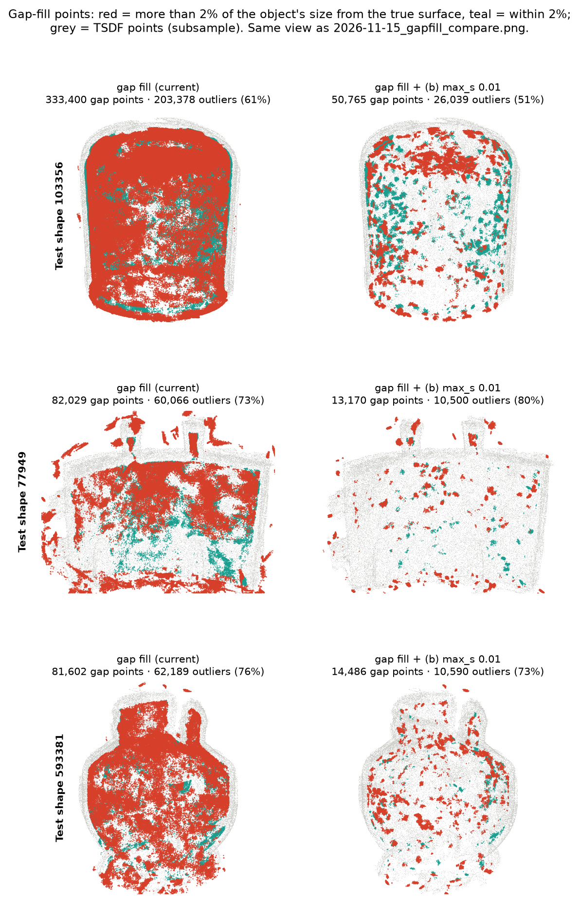

# Gap-fill outliers: where they come from and principled filters

Fahad Qaseem Khawar, 18 Nov 2026. Tables regenerated by `scripts/outliers_report.py` from `scripts/gapfill_outliers.py`; the interpretation at the end is written by hand. Base: the dense default (1M TSDF points) plus the gap points of the dense gap fill (1M kernel samples, kept when 3-10% of the extent from the nearest TSDF point; `docs/methods.md` sections 5-6). **No filter uses the GT**; the GT only labels and scores. Filter settings were chosen on pencilpot only (section 2). Outliers = exact distance to the GT surface above 0.01 / 0.02 in the normalised frame (GT extent 1), as in `docs/results/2026-11-17_equal_count.md`. Clouds are scored at their own size (1M TSDF points + the kept gap points).

## 1. Where the outliers come from

All gap points of the dense gap fill on set A and set B pooled: 1,637,588 points, of which 78.2% lie more than 0.02 from the GT surface (GT used here only to label them). For each property: the outlier rate in its four quartile bins (lowest to highest value), and the AUC for telling outliers apart (0.5 = no information; listed so that above 0.5 means the property separates them in the expected direction, given in the last column). Points without a projective TSDF value (no view has fused depth there) are left out of that row.

| property | Q1 | Q2 | Q3 | Q4 | AUC | outliers are ... |
|---|---:|---:|---:|---:|---:|---|
| source opacity | 74% | 77% | 79% | 83% | 0.56 | higher |
| source largest axis (x object size) | 75% | 76% | 78% | 84% | 0.55 | higher |
| source flatness (min / max axis) | 83% | 79% | 75% | 76% | 0.55 | lower |
| position in the kernel (max |z|, sigma) | 77% | 78% | 78% | 79% | 0.51 | higher |
| distance to nearest TSDF point (x extent) | 71% | 75% | 80% | 86% | 0.60 | higher |
| views seeing it on the object | 98% | - | - | 76% | 0.57 | lower |
| views seeing it on background | - | - | - | 78% | 0.56 | higher |
| max in-front-of-depth margin (x size) | 86% | 72% | 72% | 83% | 0.51 | lower |
| |projective TSDF| (x trunc) | 88% | 82% | - | 95% | 0.62 | higher |
| views with fused depth there | - | - | - | 78% | 0.53 | higher |

Outlier rate of the gap points per shape (> 0.02): cylinder_472094 85% of 51,277, shackbot_94155 83% of 167,259, nsphere_186199 82% of 59,282, wheel_76903 81% of 63,199, presents_98021 87% of 89,886, monsterring_1356640 97% of 10,724, cryptex_105686 78% of 11,321, 1146183 79% of 70,616, 84620 86% of 52,595, 77949 73% of 82,029, 593381 76% of 81,602, 73155 85% of 51,746, 40550 82% of 79,668, 290506 85% of 109,038, 105924 69% of 69,269, 103356 61% of 333,400, 59706 86% of 41,551, 697228 92% of 148,347, 94668 82% of 64,779.

## 2. Pilot on pencilpot (dev): all filter settings

(a) redraws the kernels at a tighter truncation (the current one is already 2 sigma); (b) source-Gaussian opacity / size; (c) multi-view free space and silhouette (m = margin in object sizes, k = views that must object); (d) projective TSDF (tau in truncation units). Carried to sets A and B (`configs/outlier_filters_chosen.json`): per family, the setting with the lowest share of points beyond 0.02 among those whose Chamfer stays below the TSDF-only cloud's (the fill must still help); for (b) also opacity >= 0.9, to answer the opacity question directly. Chamfer differences of ~0.1 between near-identical clouds are sampling noise of the 5,000-point protocol (e.g. (c) m 0.01 vs 0.02 keep 70,656 vs 70,687 points but score 5.86 vs 5.93).

| filter | points added | Chamfer | F1@0.01 | F1@0.02 | NC | recall all @0.02 | outliers > 0.01 (%) | outliers > 0.02 (%) | added points within 0.02 (%) |
|---|---:|---:|---:|---:|---:|---:|---:|---:|---:|
| TSDF only | 0 | 6.19 | 0.365 | 0.715 | 0.826 | 0.674 | 58.53 | 21.92 | - |
| gap fill (current, 2 sigma) | 76,768 | 5.87 | 0.358 | 0.722 | 0.826 | 0.765 | 61.19 | 26.11 | 19.4 |
| (a) trunc 1.5 | 74,329 | 5.87 | 0.358 | 0.719 | 0.826 | 0.748 | 61.12 | 25.98 | 19.4 |
| (a) trunc 1.0 | 71,200 | 5.86 | 0.359 | 0.719 | 0.826 | 0.727 | 61.04 | 25.81 | 19.6 |
| (b) min_op 0.7 | 58,984 | 5.97 | 0.359 | 0.721 | 0.827 | 0.744 | 60.62 | 25.25 | 18.2 |
| (b) min_op 0.9 | 29,448 | 6.05 | 0.363 | 0.719 | 0.819 | 0.717 | 59.59 | 23.68 | 16.7 |
| (b) max_s 0.02 | 57,059 | 5.99 | 0.360 | 0.721 | 0.827 | 0.740 | 60.55 | 25.03 | 20.5 |
| (b) max_s 0.01 | 13,383 | 6.15 | 0.364 | 0.719 | 0.824 | 0.699 | 59.01 | 22.64 | 23.5 |
| (b) min_op 0.7, max_s 0.02 | 42,560 | 5.98 | 0.360 | 0.720 | 0.825 | 0.724 | 60.07 | 24.31 | 19.4 |
| (c) m 0.01, k 1 | 70,656 | 5.86 | 0.357 | 0.718 | 0.825 | 0.745 | 61.00 | 25.74 | 20.1 |
| (c) m 0.01, k 2 | 73,262 | 5.91 | 0.357 | 0.723 | 0.829 | 0.762 | 61.07 | 25.87 | 20.1 |
| (c) m 0.02, k 1 | 70,687 | 5.93 | 0.357 | 0.720 | 0.825 | 0.745 | 61.00 | 25.74 | 20.2 |
| (c) m 0.02, k 2 | 73,269 | 6.00 | 0.358 | 0.723 | 0.828 | 0.762 | 61.07 | 25.87 | 20.1 |
| (c) m 0.03, k 1 | 70,704 | 6.00 | 0.359 | 0.721 | 0.824 | 0.745 | 61.00 | 25.74 | 20.2 |
| (c) m 0.03, k 2 | 73,293 | 5.93 | 0.357 | 0.723 | 0.827 | 0.762 | 61.07 | 25.88 | 20.1 |
| (d) tau 0.5 | 72,595 | 6.00 | 0.357 | 0.718 | 0.825 | 0.746 | 61.07 | 25.90 | 19.3 |
| (d) tau 0.9 | 73,865 | 5.92 | 0.357 | 0.718 | 0.825 | 0.746 | 61.12 | 25.97 | 19.2 |

## 3. Sets A and B with the chosen settings

**Set B (12 shapes, clean test set)** (mean over shapes)

| filter | points added | Chamfer | F1@0.01 | F1@0.02 | NC | recall all @0.02 | outliers > 0.01 (%) | outliers > 0.02 (%) | added points within 0.02 (%) |
|---|---:|---:|---:|---:|---:|---:|---:|---:|---:|
| TSDF only | 0 | 5.59 | 0.469 | 0.708 | 0.809 | 0.682 | 49.77 | 23.94 | - |
| gap fill (current, 2 sigma) | 98,720 | 5.32 | 0.465 | 0.731 | 0.808 | 0.827 | 52.59 | 27.96 | 20.3 |
| (a) trunc 1.0 | 92,699 | 5.34 | 0.465 | 0.725 | 0.809 | 0.787 | 52.34 | 27.62 | 20.7 |
| (b) max_s 0.01 | 20,031 | 5.46 | 0.468 | 0.719 | 0.812 | 0.732 | 50.48 | 24.88 | 23.5 |
| (b) min_op 0.9 | 41,209 | 5.37 | 0.467 | 0.725 | 0.810 | 0.774 | 51.17 | 25.94 | 18.9 |
| (c) m 0.01, k 1 | 87,791 | 5.26 | 0.468 | 0.734 | 0.809 | 0.820 | 52.14 | 27.28 | 23.4 |
| (d) tau 0.5 | 91,063 | 5.28 | 0.467 | 0.733 | 0.809 | 0.820 | 52.36 | 27.59 | 21.7 |

Paired per shape against the current gap fill: (a) trunc 1.0: outliers > 0.02 -0.34 (better on 12 of 12), Chamfer +0.03 (better on 5 of 12); (b) max_s 0.01: outliers > 0.02 -3.08 (better on 12 of 12), Chamfer +0.14 (better on 5 of 12); (b) min_op 0.9: outliers > 0.02 -2.02 (better on 11 of 12), Chamfer +0.06 (better on 5 of 12); (c) m 0.01, k 1: outliers > 0.02 -0.67 (better on 11 of 12), Chamfer -0.05 (better on 9 of 12); (d) tau 0.5: outliers > 0.02 -0.37 (better on 12 of 12), Chamfer -0.03 (better on 10 of 12).

**Set A (7 shapes)** (mean over shapes)

| filter | points added | Chamfer | F1@0.01 | F1@0.02 | NC | recall all @0.02 | outliers > 0.01 (%) | outliers > 0.02 (%) | added points within 0.02 (%) |
|---|---:|---:|---:|---:|---:|---:|---:|---:|---:|
| TSDF only | 0 | 5.56 | 0.516 | 0.751 | 0.801 | 0.735 | 44.35 | 20.41 | - |
| gap fill (current, 2 sigma) | 64,707 | 5.39 | 0.510 | 0.763 | 0.800 | 0.830 | 46.78 | 23.84 | 15.3 |
| (a) trunc 1.0 | 59,698 | 5.38 | 0.510 | 0.758 | 0.800 | 0.802 | 46.56 | 23.55 | 15.2 |
| (b) max_s 0.01 | 12,535 | 5.46 | 0.514 | 0.758 | 0.802 | 0.768 | 44.89 | 21.12 | 17.4 |
| (b) min_op 0.9 | 26,433 | 5.44 | 0.514 | 0.761 | 0.804 | 0.797 | 45.35 | 21.86 | 14.8 |
| (c) m 0.01, k 1 | 54,022 | 5.38 | 0.512 | 0.764 | 0.802 | 0.824 | 46.46 | 23.31 | 21.2 |
| (d) tau 0.5 | 58,328 | 5.40 | 0.511 | 0.763 | 0.801 | 0.824 | 46.57 | 23.53 | 16.0 |

Paired per shape against the current gap fill: (a) trunc 1.0: outliers > 0.02 -0.29 (better on 7 of 7), Chamfer -0.01 (better on 4 of 7); (b) max_s 0.01: outliers > 0.02 -2.71 (better on 7 of 7), Chamfer +0.07 (better on 2 of 7); (b) min_op 0.9: outliers > 0.02 -1.98 (better on 7 of 7), Chamfer +0.04 (better on 3 of 7); (c) m 0.01, k 1: outliers > 0.02 -0.53 (better on 7 of 7), Chamfer -0.02 (better on 4 of 7); (d) tau 0.5: outliers > 0.02 -0.31 (better on 7 of 7), Chamfer +0.01 (better on 3 of 7).

## 4. Picture

Left: all gap points of the current gap fill; right: those kept by (b) max_s 0.01. Same view and zoom as `figures/2026-11-15_gapfill_compare.png` (the meeting picture).

<!-- manual -->
## Interpretation

Written 18 Nov after all runs (pilot on pencilpot, chosen filters on 19 shapes + dev; VGGT rerun for the depth maps,
cameras identical to the original runs, kernel samples identical to the dense gap fill, both checked in the script).

- **78% of the gap points are outliers** (more than 0.02 from the GT surface; 61% to 97% per shape). The gap fill still
  lowers Chamfer (set B 5.59 to 5.32) because the remaining ~20% land where the TSDF has nothing, which the recall side
  of Chamfer rewards more than the precision side penalises a few % more stray points.
- **The outliers do not come from one kind of Gaussian.** No property of the source Gaussian separates them: opacity
  (AUC 0.56, and outliers come slightly more from *high* opacity), size (0.55, more from large Gaussians), flatness (0.55),
  position inside the kernel (0.51: 2 sigma truncation is not the problem; 1 sigma removes 6% of the points and 0.3 points of
  outliers). The best single indicator is the distance to the TSDF cloud itself (0.60: the farther into the gap, the worse).
- **Why the multi-view checks catch so little: the gaps are surfaces no view sees.** 91.5% of the gap points have no
  fused depth at or behind them in any view, yet 89% project onto the object's silhouette in all 8 views.
  *Corrected 17 Nov* (`docs/results/2026-11-17_conf_ablation.md`): this first said they lie on pixels the pipeline
  filtered out by low confidence. They do not: the confidence percentile is inert on our renders, and re-checking with
  the saved depth maps shows that 99.4% of these points lie behind a fused surface in at least one view (94% behind
  fused depth or on background in every view that sees them); only 0.3% depend only on the 2 px rim. They are occluded
  surface (undersides, concavities), and the Gaussians there fill unseen volume behind the silhouettes. Where a view does have evidence the
  checks are accurate (points seen on background by a view: 98% outliers; in front of the fused depth: 94% outliers),
  but that covers only ~11% of the points.
- **Filters on sets A and B** (paired against the current gap fill):
  (c) free space + silhouette is the only one that improves both: outliers > 0.02 -0.7 points (better on 11 of 12, set B),
  Chamfer -0.05 (9 of 12), precision of the added points 20% to 23%. (d) |TSDF| behaves similarly but weaker.
  (b) opacity >= 0.9 or largest axis <= 1% of the object cut outliers by 2-3 points on every shape, but only by deleting
  60-80% of the added points; their precision stays at 19-24%, and Chamfer and recall move back towards TSDF-only.
  (a) tighter truncation changes almost nothing.
- **Conclusion:** the gap points are mostly wrong because they are reconstructions of exactly the image regions VGGT
  is unsure about, not because of a bad Gaussian subset that a threshold could remove. Principled filters can only
  remove what some view contradicts; in these regions nothing does. The cheap safe step is to keep (c) (free space +
  silhouette, margin 1% of the object, one contradicting view). The real fix has to add evidence for those regions:
  more views (15 Nov: 16 views raise recall on every shape), or Gaussians trained with a depth or normal prior. (A free-space test against
  VGGT's unfiltered depth was proposed here; the 17 Nov check shows there is almost no unfiltered foreground depth to
  use, so it is dropped.)
- **Noise floor of the protocol:** Chamfer differences of ~0.1 between near-identical clouds come from the 5,000-point
  random subsample (section 2). Differences below that should not be read as effects; the outlier percentages, computed
  on every point, are the stable numbers here.
