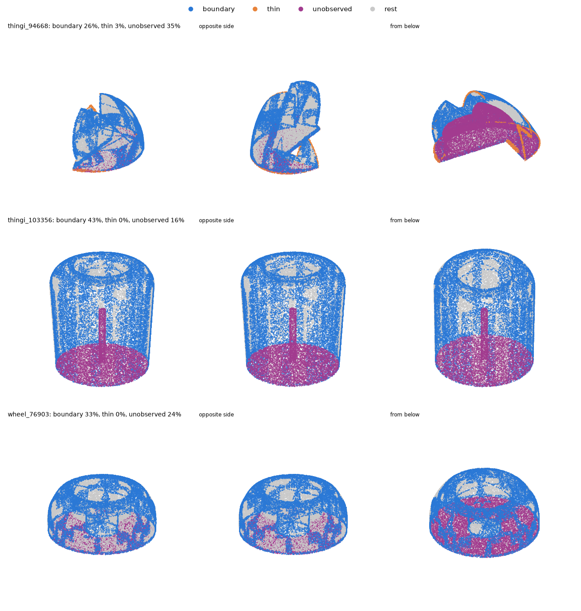
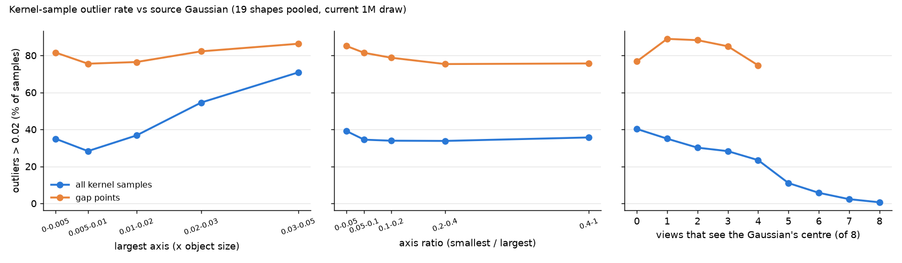

# Prof. Zhong's follow-ups of 17 Nov: point map vs TSDF, Gaussian thresholds by region, points per Gaussian, MeshFlow paper vs release, evaluation consistency

Fahad Qaseem Khawar, 19 Nov 2026. Generated by `scripts/zhong_report.py`; interpretation by hand. Set B = 12 new shapes (clean test set), set A = 7 original shapes. Pencilpot (dev) is in no table and no mean, and nothing was tuned. Mean ± std over shapes. Protocol v1: camera alignment only (no ICP), normalised frame with GT extent 1. Outliers = exact distance to the GT triangles; signed offset = median distance along the GT face normal (> 0 = outside).

<!-- summary -->
**Summary**
1. **TSDF fusion makes the cloud more consistent but loses some coverage.** Fusion is (c) TSDF vs (b) the same depth
   pixels unfused (set B).
   - Consistency improves: Chamfer 6.07 -> 5.58 (better on 12 of 12); outliers > 0.02 31.2% -> 23.9% (12 of 12);
     signed offset +0.011 -> +0.007 (11 of 12). It averages the views and halves the outward depth bias.
   - It costs recall all @0.02 0.740 -> 0.682 (worse on 12 of 12) and NC 0.826 -> 0.809. The TSDF drops thin or
     single-view parts and smooths normals.
   - VGGT's point head is worse than both on every accuracy metric: Chamfer 8.12, outliers > 0.02 56%, offset +0.018,
     worse on 12 of 12. It cannot use the known focal, so it carries VGGT's 4-11% short focal. (b) with the known focal
     is the right unfused baseline. Set A agrees (TSDF Chamfer better on 6 of 7, recall worse on 7 of 7).
2. **No opacity / size threshold makes the gap points accurate in any region.**
   - Their precision (share within 0.02 of the GT) ranges over all 12 settings by region:

     | region | precision |
     |---|---|
     | thin | 2-5% |
     | boundary | 15-25% |
     | rest | 19-32% |
     | unobserved | 29-41% |

   - The TSDF gap sits mostly in surface no view sees: 83% of the unobserved region is gap, against 11-17% elsewhere.
   - Tighter thresholds trade fill for a few points of precision. Largest axis <= 0.01: precision 24% -> 29%, but the gap
     filled drops 46% -> 17%. Higher opacity adds points and lowers precision. The current o 0.5 / a 0.05 has the best
     Chamfer (5.32).
3. **The ~83 is n / N** (1M samples over ~12k kept Gaussians). It holds for any weights; opacity in [0.5, 1] only moves
   the expected count of a single Gaussian within a factor of 2.
   - At equal totals, the allocation hardly matters: Chamfer 5.70-5.83, precision 58-66%.
   - Fixed k is marginally best: Chamfer -0.1, precision +1.5.
   - Area weighting is the most uniform (nearest-neighbour CV 0.55 vs 0.68) and fills the most gap (+5 points), but is
     the least precise (58%). Large Gaussians are the inaccurate ones: outlier rate 28% at a largest axis of 0.5-1% of
     the object, 71% at 3-5%.
   - Disk sampling brings nothing (less uniform, fills less).
   - The strongest predictor of an outlier is visibility: 40% of samples are outliers when no view sees the Gaussian's
     centre, 0.6% when all 8 do. But 87% of gap points come from centres no view sees.
4. **MeshFlow paper vs release:** see `docs/meshflow_public_vs_paper.md`. Point count, encoder, vertex-count control and
   DiT size differ from the CVPR supplementary; the training data of the release is not stated.
5. **Evaluation consistency:** every protocol v1 row of the 16-19 Nov reports uses the same normalisation, camera-only
   alignment, 1M points with seed 0 and the same metrics (`scripts/eval_audit.py`). There are six labelled exceptions
   (ICP rows, the 18 Nov outlier clouds, mesh rows, one 5k-subsample difference, one wording fix, GT sample seeds), all
   listed in `docs/eval_protocol.md` section 6.
<!-- /summary -->

## 1. VGGT point map vs unprojected depth vs TSDF

**Method.** One VGGT pass per shape on the 8 default views, rerun under the memory guard with the raw output kept (`scripts/pm_run.sh`; the rerun has the same cameras, the same fused-pixel count and the same alignment as the 15 Nov `<s>_dense` run on every shape). `scripts/pointmap_clouds.py` keeps **the same pixels for (a) and (b)**: the default TSDF pixel filter (conf > 1, 2 px foreground erosion; the percentile is inert, 17 Nov), computed once from the depth head. (a) = the point head's `world_points` at those pixels, in VGGT's world frame. The point head cannot take the known focal, so it carries VGGT's own focal implicitly. (b) = the depth head's depth at those pixels, unprojected with the known focal. These are exactly the points the TSDF fuses. (c) = the current TSDF cloud (1M points sampled from the fused surface). Normals for (a) and (b): PCA over 20 neighbours, flipped towards the camera that saw the point (the v2 points stage). All three use the same camera alignment (Umeyama on VGGT's camera centres, one sim3, no ICP) and protocol v1 at **exactly 1,000,000 points** (`default_rng(0)`). (a) and (b) have 0.42M to 1.07M kept pixels, so most are drawn with replacement. This repeats points but leaves every metric's expectation unchanged: CD and F1 use random subsamples, recall uses the point set, outliers are a share.

**Set B (12 shapes, clean test set)**

| points | Chamfer | F1@0.01 | F1@0.02 | NC | recall all @0.02 | outliers > 0.01 (%) | outliers > 0.02 (%) | signed offset |
|---|---:|---:|---:|---:|---:|---:|---:|---:|
| (a) VGGT point head (world_points), no fusion | 8.12 ± 2.96 | 0.213 ± 0.181 | 0.416 ± 0.243 | 0.832 ± 0.042 | 0.430 ± 0.230 | 77.7 ± 20.2 | 56.3 ± 26.4 | 0.0180 ± 0.0097 |
| (b) depth maps unprojected with the known focal, no fusion | 6.07 ± 1.95 | 0.444 ± 0.181 | 0.690 ± 0.153 | 0.826 ± 0.031 | 0.740 ± 0.096 | 58.4 ± 19.2 | 31.2 ± 20.0 | 0.0111 ± 0.0060 |
| (c) TSDF fusion of (b) (current default) | 5.58 ± 1.80 | 0.469 ± 0.203 | 0.708 ± 0.160 | 0.809 ± 0.026 | 0.682 ± 0.136 | 49.8 ± 22.8 | 23.9 ± 18.9 | 0.0065 ± 0.0059 |

Paired per shape:

- TSDF (c) minus unprojected depth (b), the effect of fusion: Chamfer -0.49 (better on 12 of 12); F1@0.01 +0.025 (better on 7 of 12); F1@0.02 +0.018 (better on 9 of 12); NC -0.017 (better on 2 of 12); recall all @0.02 -0.058 (better on 0 of 12); outliers > 0.01 (%) -8.7 (better on 10 of 12); outliers > 0.02 (%) -7.2 (better on 12 of 12); |signed offset| -0.0046 (better on 11 of 12).
- point head (a) minus unprojected depth (b): Chamfer +2.05 (better on 0 of 12); F1@0.01 -0.231 (better on 0 of 12); F1@0.02 -0.275 (better on 0 of 12); NC +0.005 (better on 8 of 12); recall all @0.02 -0.310 (better on 0 of 12); outliers > 0.01 (%) +19.3 (better on 0 of 12); outliers > 0.02 (%) +25.2 (better on 0 of 12); |signed offset| +0.0068 (better on 1 of 12).

**Set A (7 shapes)**

| points | Chamfer | F1@0.01 | F1@0.02 | NC | recall all @0.02 | outliers > 0.01 (%) | outliers > 0.02 (%) | signed offset |
|---|---:|---:|---:|---:|---:|---:|---:|---:|
| (a) VGGT point head (world_points), no fusion | 7.90 ± 4.35 | 0.351 ± 0.264 | 0.558 ± 0.302 | 0.820 ± 0.085 | 0.542 ± 0.271 | 60.3 ± 31.9 | 39.6 ± 35.2 | 0.0135 ± 0.0104 |
| (b) depth maps unprojected with the known focal, no fusion | 5.94 ± 2.26 | 0.508 ± 0.205 | 0.731 ± 0.185 | 0.818 ± 0.053 | 0.769 ± 0.111 | 50.0 ± 26.6 | 25.6 ± 26.6 | 0.0084 ± 0.0073 |
| (c) TSDF fusion of (b) (current default) | 5.57 ± 1.93 | 0.515 ± 0.188 | 0.752 ± 0.149 | 0.802 ± 0.063 | 0.735 ± 0.110 | 44.4 ± 25.6 | 20.4 ± 20.6 | 0.0044 ± 0.0035 |

Paired per shape:

- TSDF (c) minus unprojected depth (b), the effect of fusion: Chamfer -0.37 (better on 6 of 7); F1@0.01 +0.007 (better on 5 of 7); F1@0.02 +0.021 (better on 4 of 7); NC -0.016 (better on 3 of 7); recall all @0.02 -0.034 (better on 0 of 7); outliers > 0.01 (%) -5.7 (better on 5 of 7); outliers > 0.02 (%) -5.2 (better on 4 of 7); |signed offset| -0.0041 (better on 6 of 7).
- point head (a) minus unprojected depth (b): Chamfer +1.95 (better on 0 of 7); F1@0.01 -0.158 (better on 0 of 7); F1@0.02 -0.174 (better on 0 of 7); NC +0.003 (better on 4 of 7); recall all @0.02 -0.226 (better on 0 of 7); outliers > 0.01 (%) +10.3 (better on 1 of 7); outliers > 0.02 (%) +14.0 (better on 0 of 7); |signed offset| +0.0049 (better on 1 of 7).

**Per shape** (Chamfer / outliers > 0.02 % / signed offset)

| shape | kept pixels | point head vs (b), median (% of depth) | (a) point head | (b) unprojected depth | (c) TSDF |
|---|---:|---:|---:|---:|---:|
| thingi_1146183 (B) | 1,000,721 | 1.35 | 11.48 / 53.1 / +0.0201 | 9.15 / 17.4 / +0.0100 | 8.54 / 7.5 / +0.0038 |
| thingi_84620 (B) | 522,226 | 2.06 | 7.19 / 75.8 / +0.0223 | 4.81 / 28.8 / +0.0100 | 4.25 / 17.7 / +0.0030 |
| thingi_77949 (B) | 568,048 | 1.75 | 8.66 / 83.7 / +0.0061 | 5.65 / 61.4 / +0.0091 | 5.53 / 61.1 / +0.0120 |
| thingi_593381 (B) | 934,701 | 2.01 | 12.12 / 84.7 / +0.0271 | 8.78 / 54.7 / +0.0201 | 7.81 / 39.1 / +0.0143 |
| thingi_73155 (B) | 633,998 | 0.66 | 4.77 / 13.4 / +0.0068 | 4.23 / 3.2 / +0.0053 | 3.74 / 1.6 / +0.0019 |
| thingi_40550 (B) | 910,249 | 1.10 | 4.96 / 27.2 / +0.0118 | 4.27 / 15.9 / +0.0078 | 3.91 / 11.3 / +0.0031 |
| thingi_290506 (B) | 458,436 | 1.07 | 5.43 / 34.3 / +0.0145 | 4.36 / 18.1 / +0.0082 | 3.90 / 7.1 / +0.0045 |
| thingi_105924 (B) | 858,860 | 1.17 | 5.85 / 40.9 / +0.0121 | 4.99 / 22.5 / +0.0088 | 4.81 / 20.8 / +0.0011 |
| thingi_103356 (B) | 1,073,296 | 2.45 | 13.15 / 89.7 / +0.0375 | 9.10 / 66.4 / +0.0251 | 8.40 / 55.5 / +0.0200 |
| thingi_59706 (B) | 739,716 | 1.13 | 5.58 / 29.8 / +0.0076 | 4.81 / 17.1 / +0.0049 | 4.42 / 16.1 / +0.0028 |
| thingi_697228 (B) | 964,554 | 1.71 | 9.46 / 73.6 / +0.0242 | 7.19 / 37.3 / +0.0146 | 6.48 / 25.3 / +0.0085 |
| thingi_94668 (B) | 671,069 | 2.32 | 8.78 / 69.5 / +0.0256 | 5.51 / 30.9 / +0.0095 | 5.16 / 24.1 / +0.0031 |
| cylinder_472094 | 422,165 | 1.81 | 4.49 / 33.8 / +0.0087 | 3.32 / 21.5 / +0.0016 | 3.45 / 21.8 / +0.0037 |
| shackbot_94155 | 911,142 | 2.78 | 14.91 / 85.2 / +0.0285 | 9.56 / 55.6 / +0.0199 | 8.28 / 36.5 / +0.0108 |
| nsphere_186199 | 779,876 | 3.80 | 13.44 / 85.7 / +0.0274 | 8.33 / 66.5 / +0.0157 | 7.93 / 57.1 / +0.0067 |
| wheel_76903 | 1,073,296 | 0.84 | 5.90 / 19.0 / +0.0107 | 5.18 / 1.8 / +0.0066 | 4.89 / 0.6 / +0.0033 |
| presents_98021 | 993,102 | 0.57 | 5.19 / 6.0 / +0.0060 | 5.15 / 4.7 / +0.0070 | 4.69 / 9.3 / +0.0039 |
| monsterring_1356640 | 1,073,296 | 0.41 | 6.17 / 0.0 / +0.0015 | 6.07 / 0.0 / -0.0006 | 6.04 / 0.0 / -0.0002 |
| cryptex_105686 | 903,465 | 1.94 | 5.16 / 47.2 / +0.0116 | 3.99 / 29.1 / +0.0087 | 3.72 / 17.6 / +0.0029 |

<!-- interp1 -->
**Reading.** (b) -> (c) isolates fusion. The same pixels, the same cameras and the same alignment go in; only the TSDF
differs.
- **Fusion reduces error.** It cuts outliers and Chamfer on every set B shape and halves the outward offset, because
  the TSDF averages the 8 views' depths.
- **Fusion also removes surface.** "Recall all" drops on every shape (set B 0.740 -> 0.682, set A 0.769 -> 0.735).
  Surface seen in one view with a thin or noisy footprint does not survive extraction and the 1% component filter.
- **(a) vs (b) is not a clean head-to-head.** The point head encodes VGGT's own focal, which is 4-11% short (19 Nov),
  while (b) uses the known focal. Its larger outward offset (+0.018 vs +0.011) fits that, and its NC is comparable.
  Without a known-focal input, the point head is not an option for us.
- **Answer to the question:** TSDF fusion improves consistency and adds no error. What it costs is coverage, which the
  gap fill was built to recover.
<!-- /interp1 -->

## 2. Opacity / scale thresholds by GT region

**Regions** (`scripts/gt_regions.py`). They are labelled on the 100k GT surface samples of the protocol sampler; the GT is used only for these labels and for scoring. No filter or sampler reads it. Regions may overlap.
- **boundary**: some input view sees the sample within 3 px of the GT silhouette or of an occlusion edge (neighbouring GT depths differ by > 2%). The input filter erodes VGGT's foreground by 2 px, so this is where pixels are lost.
- **thin**: local thickness < 0.03 of the extent. Thickness = median distance to the opposite GT surface along the inward normal and 4 rays at 20 deg around it. Inward is decided by an occupancy test, so face orientation does not matter.
- **unobserved**: none of the 8 input views sees the sample (outside every image, or occluded; GT ray casting from the render cameras; silhouettes checked against the renders, IoU 0.99).

**Thresholds.** For each opacity >= o and largest axis <= a x object size, the 1M opacity-weighted kernel samples are redrawn from the Gaussians that pass (seed 0, 2 sigma). The gap points are then selected exactly as the pipeline does: 3-10% of the TSDF cloud's extent from the nearest TSDF point. o 0.5 / a 0.05 is the current gap fill. Per region:
- **added**: gap points whose nearest GT sample is in the region, mean per shape;
- **precision**: share of them within 0.02 of the GT surface (exact distance), pooled over shapes;
- **filled**: share of the region's TSDF gap (GT samples > 0.02 from the TSDF cloud) that now has an added point within 0.02, mean over shapes.

**Set B (12 shapes)**: region sizes, % of the GT surface (mean): boundary / silhouette-adjacent 40.9 (TSDF gap inside it 11%), thin 2.1 (TSDF gap inside it 19%), unobserved 23.4 (TSDF gap inside it 83%), rest 35.0 (TSDF gap inside it 17%).

| opacity >= | max axis <= | boundary / silhouette-adjacent: added / precision % / filled % | thin (< 3% of extent): added / precision % / filled % | unobserved (no view): added / precision % / filled % | rest (none of the three): added / precision % / filled % | whole surface: added / precision % / filled % | filled cloud: Chamfer / outliers > 0.02 % |
|---:|---:|---:|---:|---:|---:|---:|---:|
| 0.3 | 0.01 | 21,404 / 25 / 27.9 | 1,304 / 5 / 28.3 | 8,537 / 41 / 15.1 | 16,782 / 32 / 32.2 | 46,761 / 31 / 19.9 | 5.45 / 25.6 |
| 0.3 | 0.02 | 31,004 / 21 / 50.5 | 1,461 / 4 / 52.4 | 13,680 / 37 / 32.3 | 28,432 / 28 / 60.3 | 73,226 / 27 / 39.4 | 5.35 / 26.7 |
| 0.3 | 0.05 | 36,119 / 19 / 54.4 | 1,911 / 3 / 54.9 | 17,452 / 35 / 40.7 | 33,568 / 26 / 64.7 | 87,294 / 25 / 47.7 | 5.33 / 27.5 |
| 0.5 | 0.01 | 23,916 / 24 / 24.3 | 1,480 / 4 / 27.6 | 10,258 / 39 / 14.0 | 17,606 / 29 / 28.6 | 51,823 / 29 / 17.4 | 5.44 / 25.9 |
| 0.5 | 0.02 | 34,577 / 20 / 46.0 | 1,625 / 4 / 47.7 | 16,435 / 37 / 31.6 | 31,136 / 26 / 55.6 | 82,259 / 26 / 37.5 | 5.36 / 27.1 |
| 0.5 (current) | 0.05 | 40,600 / 18 / 51.3 | 2,190 / 3 / 55.0 | 20,994 / 34 / 40.1 | 36,966 / 24 / 60.1 | 98,720 / 24 / 45.9 | 5.32 / 28.0 |
| 0.7 | 0.01 | 27,180 / 23 / 18.2 | 1,870 / 4 / 22.8 | 12,871 / 38 / 11.6 | 18,602 / 26 / 19.1 | 58,712 / 27 / 13.5 | 5.49 / 26.2 |
| 0.7 | 0.02 | 39,379 / 19 / 39.4 | 2,078 / 3 / 44.1 | 21,468 / 36 / 28.1 | 34,421 / 24 / 44.8 | 95,391 / 24 / 33.7 | 5.39 / 27.7 |
| 0.7 | 0.05 | 46,729 / 17 / 44.5 | 2,767 / 3 / 50.5 | 27,255 / 33 / 38.3 | 41,424 / 22 / 50.2 | 115,581 / 23 / 43.2 | 5.34 / 28.7 |
| 0.9 | 0.01 | 30,018 / 24 / 12.3 | 2,450 / 4 / 26.5 | 14,732 / 31 / 7.8 | 16,271 / 23 / 12.7 | 61,084 / 25 / 8.5 | 5.58 / 26.3 |
| 0.9 | 0.02 | 41,225 / 18 / 28.5 | 2,853 / 3 / 37.6 | 28,353 / 30 / 21.3 | 31,095 / 20 / 27.4 | 100,857 / 22 / 24.1 | 5.48 / 28.1 |
| 0.9 | 0.05 | 49,667 / 15 / 35.1 | 3,987 / 2 / 44.4 | 36,431 / 29 / 31.8 | 38,809 / 19 / 33.7 | 125,172 / 20 / 34.5 | 5.40 / 29.3 |

TSDF alone (no gap points), same shapes: Chamfer 5.58, outliers > 0.02 23.9%. (The filled-cloud columns score TSDF 1M + all added points, not redrawn to 1M, as in the 18 Nov outlier report.)

**Set A (7 shapes)**: region sizes, % of the GT surface (mean): boundary / silhouette-adjacent 39.4 (TSDF gap inside it 9%), thin 3.1 (TSDF gap inside it 12%), unobserved 24.7 (TSDF gap inside it 77%), rest 35.1 (TSDF gap inside it 11%).

| opacity >= | max axis <= | boundary / silhouette-adjacent: added / precision % / filled % | thin (< 3% of extent): added / precision % / filled % | unobserved (no view): added / precision % / filled % | rest (none of the three): added / precision % / filled % | whole surface: added / precision % / filled % | filled cloud: Chamfer / outliers > 0.02 % |
|---:|---:|---:|---:|---:|---:|---:|---:|
| 0.3 | 0.01 | 11,572 / 12 / 33.5 | 556 / 4 / 27.7 | 5,273 / 45 / 17.0 | 7,760 / 11 / 18.1 | 24,657 / 18 / 18.4 | 5.48 / 21.7 |
| 0.3 | 0.02 | 19,618 / 10 / 53.9 | 920 / 4 / 37.2 | 9,245 / 47 / 33.2 | 16,198 / 9 / 34.9 | 45,151 / 17 / 34.2 | 5.43 / 22.8 |
| 0.3 | 0.05 | 24,137 / 9 / 58.4 | 1,186 / 3 / 38.6 | 12,547 / 42 / 39.1 | 20,256 / 8 / 40.6 | 57,046 / 16 / 40.4 | 5.42 / 23.5 |
| 0.5 | 0.01 | 12,846 / 12 / 30.2 | 698 / 4 / 27.8 | 6,203 / 44 / 16.1 | 8,034 / 11 / 15.0 | 27,138 / 19 / 16.5 | 5.49 / 21.8 |
| 0.5 | 0.02 | 21,966 / 10 / 51.5 | 1,151 / 3 / 34.7 | 10,994 / 48 / 33.2 | 17,655 / 9 / 32.3 | 50,726 / 18 / 33.1 | 5.44 / 23.1 |
| 0.5 (current) | 0.05 | 27,143 / 9 / 58.2 | 1,465 / 2 / 36.4 | 15,050 / 42 / 39.2 | 22,385 / 8 / 38.8 | 64,707 / 16 / 39.8 | 5.39 / 23.8 |
| 0.7 | 0.01 | 13,779 / 13 / 26.5 | 840 / 5 / 26.4 | 7,256 / 44 / 13.2 | 8,214 / 9 / 12.6 | 29,313 / 20 / 13.6 | 5.49 / 21.9 |
| 0.7 | 0.02 | 24,742 / 10 / 47.4 | 1,462 / 2 / 35.4 | 13,625 / 48 / 31.7 | 18,508 / 8 / 29.5 | 57,011 / 18 / 30.6 | 5.46 / 23.4 |
| 0.7 | 0.05 | 31,589 / 9 / 54.2 | 1,891 / 2 / 35.6 | 18,606 / 42 / 37.8 | 24,745 / 7 / 35.9 | 75,094 / 16 / 37.7 | 5.39 / 24.4 |
| 0.9 | 0.01 | 15,027 / 10 / 17.9 | 1,269 / 1 / 20.1 | 7,728 / 47 / 7.2 | 8,228 / 9 / 6.6 | 31,109 / 19 / 7.8 | 5.54 / 22.1 |
| 0.9 | 0.02 | 25,970 / 8 / 34.9 | 2,059 / 1 / 27.4 | 16,444 / 49 / 24.1 | 17,259 / 7 / 19.1 | 59,909 / 19 / 22.2 | 5.50 / 23.5 |
| 0.9 | 0.05 | 33,988 / 7 / 44.3 | 2,723 / 1 / 32.2 | 23,049 / 42 / 32.1 | 23,762 / 6 / 26.7 | 81,049 / 17 / 30.3 | 5.45 / 24.7 |

TSDF alone (no gap points), same shapes: Chamfer 5.57, outliers > 0.02 20.4%. (The filled-cloud columns score TSDF 1M + all added points, not redrawn to 1M, as in the 18 Nov outlier report.)

*GT surface samples coloured by region (priority where they overlap: unobserved > thin > boundary). Grey = rest.*

<!-- interp2 -->
**Reading.**
- **Where the gap is.** It is mostly surface no input view sees: 83% of the unobserved region on set B (77% on set A),
  against 11-19% elsewhere. The 2 px erosion costs little: only 11% of the boundary region is gap.
- **How well the gap points do by region.**
  - Unobserved: their precision is the highest of any region (29-41%), because there the Gaussians' guesses are the
    only points.
  - Thin parts: precision is near zero (2-5%), and thin parts are only 2-3% of the surface.
- **What the thresholds do.**
  - Size (largest axis) is the lever. 0.01 raises precision by about 5 points in every region, but halves to thirds the
    gap filled.
  - Opacity barely matters between 0.3 and 0.5. Raising it to 0.7-0.9 adds points and lowers precision, because the
    sampler's 1M points go to fewer Gaussians.
  - No setting separates good from bad gap points within a region. This agrees with the 18 Nov finding (AUC <= 0.62 for
    any Gaussian property).
- **Recommendation:** keep the current thresholds; they have the best Chamfer of the 12 settings.
<!-- /interp2 -->

## 3. Points per Gaussian

**Why the average is ~83.** The gap fill draws n = 1,000,000 kernel samples (`gaussians.py` `sample_kernels`). Each sample picks one Gaussian from those passing the filter (opacity >= 0.5, largest axis <= 0.05 x object size). The probability is proportional to its opacity, p_i = alpha_i / sum_j alpha_j. So the counts are one multinomial draw, (c_1, ..., c_N) ~ Multinomial(n, p), and E[c_i] = n alpha_i / sum_j alpha_j. Averaged over the N kept Gaussians, the mean count is **exactly n / N** whatever the weights, because the counts sum to n. The weights only move points between Gaussians. Over the 19 shapes N = 7,906 to 17,560 (median 11,903), so n / N = 57 to 126, **mean 89** (set B 90). Opacity runs only from 0.5 to 1, so the expected count of a single Gaussian stays within a factor of 2: 58 to 116 (means over shapes). The count ignores the Gaussian's size, so a large splat and a tiny one get about the same number of points, and big splats are sampled sparsely.

**Comparison at the same total count.** For each k in {20, 50, 83, 150} the total is T = k x N (per shape), and four allocations of T samples over the same kept Gaussians are compared:
- (a) opacity-weighted multinomial (current rule);
- (b) exactly k per Gaussian;
- (c) area-weighted multinomial, count proportional to s1 s2 of the two largest axes (uniform density);
- (d) the opacity-weighted counts of (a), with points drawn on the disk of the two largest axes (smallest axis z = 0, surface-aligned).
Kernel sampling as before (2 sigma truncation; normals = the source Gaussian's centre PCA normal). Metrics on the whole kernel cloud, in protocol v1's frame:
- protocol v1 (Chamfer, F1@0.01, NC);
- precision = share within 0.02 of the GT surface (exact distance);
- **density uniformity** = coefficient of variation (std / mean) of each point's nearest-neighbour distance, lower = more uniform;
- as a gap fill (3-10% band from the TSDF cloud): % of the TSDF gap filled and the precision of the added points.

**Set B (12 shapes, clean test set)**

| total | allocation | points | Chamfer | F1@0.01 | NC | precision (%) | outliers > 0.01 (%) | NN distance CV | per-Gaussian count CV | gap filled (%) | gap points' precision (%) |
|---|---|---:|---:|---:|---:|---:|---:|---:|---:|---:|---:|
| 20 N | (a) opacity-weighted (current rule) | 229,590 | 5.83 ± 1.40 | 0.392 ± 0.086 | 0.761 ± 0.042 | 64.0 ± 10.6 | 64.0 ± 7.8 | 0.66 ± 0.02 | 0.30 ± 0.00 | 36.4 ± 14.6 | 20.5 ± 8.6 |
| 20 N | (b) fixed k per Gaussian | 229,590 | 5.71 ± 1.38 | 0.405 ± 0.086 | 0.767 ± 0.043 | 65.5 ± 10.4 | 62.8 ± 7.7 | 0.65 ± 0.01 | 0.00 ± 0.00 | 36.2 ± 14.8 | 20.5 ± 9.2 |
| 20 N | (c) area-weighted (s1 s2) | 229,590 | 5.73 ± 1.20 | 0.377 ± 0.066 | 0.776 ± 0.043 | 58.5 ± 8.0 | 68.2 ± 5.3 | 0.54 ± 0.01 | 1.16 ± 0.09 | 43.7 ± 14.4 | 19.2 ± 9.0 |
| 20 N | (d) surface-aligned disk, opacity-weighted | 229,590 | 5.83 ± 1.41 | 0.386 ± 0.086 | 0.761 ± 0.044 | 64.3 ± 10.6 | 64.0 ± 7.8 | 0.75 ± 0.02 | 0.30 ± 0.00 | 33.8 ± 14.0 | 20.2 ± 8.8 |
| 50 N | (a) opacity-weighted (current rule) | 573,975 | 5.82 ± 1.41 | 0.392 ± 0.086 | 0.761 ± 0.044 | 64.0 ± 10.6 | 64.0 ± 7.8 | 0.68 ± 0.01 | 0.25 ± 0.00 | 42.7 ± 15.6 | 20.3 ± 8.6 |
| 50 N | (b) fixed k per Gaussian | 573,975 | 5.70 ± 1.40 | 0.406 ± 0.087 | 0.767 ± 0.043 | 65.5 ± 10.4 | 62.8 ± 7.8 | 0.66 ± 0.01 | 0.00 ± 0.00 | 42.8 ± 15.4 | 20.5 ± 9.1 |
| 50 N | (c) area-weighted (s1 s2) | 573,975 | 5.72 ± 1.22 | 0.377 ± 0.066 | 0.776 ± 0.043 | 58.4 ± 8.0 | 68.3 ± 5.2 | 0.55 ± 0.01 | 1.15 ± 0.10 | 48.5 ± 15.0 | 19.1 ± 9.0 |
| 50 N | (d) surface-aligned disk, opacity-weighted | 573,975 | 5.82 ± 1.40 | 0.386 ± 0.086 | 0.760 ± 0.043 | 64.3 ± 10.6 | 64.0 ± 7.8 | 0.77 ± 0.02 | 0.25 ± 0.00 | 38.7 ± 14.8 | 20.3 ± 8.7 |
| 83 N | (a) opacity-weighted (current rule) | 952,798 | 5.80 ± 1.40 | 0.393 ± 0.086 | 0.761 ± 0.043 | 64.0 ± 10.6 | 64.0 ± 7.7 | 0.68 ± 0.01 | 0.23 ± 0.00 | 45.7 ± 15.7 | 20.3 ± 8.6 |
| 83 N | (b) fixed k per Gaussian | 952,798 | 5.73 ± 1.38 | 0.405 ± 0.086 | 0.766 ± 0.043 | 65.5 ± 10.4 | 62.9 ± 7.8 | 0.67 ± 0.01 | 0.00 ± 0.00 | 45.4 ± 15.7 | 20.6 ± 9.0 |
| 83 N | (c) area-weighted (s1 s2) | 952,798 | 5.73 ± 1.20 | 0.377 ± 0.066 | 0.776 ± 0.044 | 58.4 ± 8.1 | 68.4 ± 5.3 | 0.56 ± 0.01 | 1.15 ± 0.09 | 50.6 ± 15.2 | 19.1 ± 9.0 |
| 83 N | (d) surface-aligned disk, opacity-weighted | 952,798 | 5.83 ± 1.42 | 0.385 ± 0.085 | 0.761 ± 0.043 | 64.3 ± 10.6 | 64.0 ± 7.8 | 0.79 ± 0.02 | 0.23 ± 0.00 | 41.0 ± 15.0 | 20.2 ± 8.8 |
| 150 N | (a) opacity-weighted (current rule) | 1,721,925 | 5.83 ± 1.43 | 0.392 ± 0.086 | 0.761 ± 0.043 | 64.0 ± 10.6 | 64.0 ± 7.7 | 0.68 ± 0.01 | 0.22 ± 0.00 | 48.4 ± 15.6 | 20.3 ± 8.6 |
| 150 N | (b) fixed k per Gaussian | 1,721,925 | 5.71 ± 1.38 | 0.405 ± 0.086 | 0.767 ± 0.043 | 65.5 ± 10.4 | 62.8 ± 7.8 | 0.67 ± 0.01 | 0.00 ± 0.00 | 48.4 ± 15.8 | 20.5 ± 9.1 |
| 150 N | (c) area-weighted (s1 s2) | 1,721,925 | 5.70 ± 1.20 | 0.377 ± 0.066 | 0.776 ± 0.043 | 58.4 ± 8.1 | 68.3 ± 5.3 | 0.56 ± 0.01 | 1.15 ± 0.09 | 52.6 ± 15.3 | 19.1 ± 9.0 |
| 150 N | (d) surface-aligned disk, opacity-weighted | 1,721,925 | 5.83 ± 1.40 | 0.386 ± 0.086 | 0.761 ± 0.043 | 64.3 ± 10.6 | 64.0 ± 7.8 | 0.81 ± 0.02 | 0.22 ± 0.00 | 43.3 ± 15.2 | 20.3 ± 8.7 |

**Set A (7 shapes)**

| total | allocation | points | Chamfer | F1@0.01 | NC | precision (%) | outliers > 0.01 (%) | NN distance CV | per-Gaussian count CV | gap filled (%) | gap points' precision (%) |
|---|---|---:|---:|---:|---:|---:|---:|---:|---:|---:|---:|
| 20 N | (a) opacity-weighted (current rule) | 254,703 | 6.08 ± 1.88 | 0.405 ± 0.134 | 0.742 ± 0.079 | 66.6 ± 18.7 | 60.9 ± 14.2 | 0.67 ± 0.05 | 0.30 ± 0.00 | 32.2 ± 24.7 | 15.4 ± 6.1 |
| 20 N | (b) fixed k per Gaussian | 254,703 | 6.00 ± 1.88 | 0.416 ± 0.136 | 0.745 ± 0.080 | 67.4 ± 18.6 | 60.2 ± 14.3 | 0.66 ± 0.05 | 0.00 ± 0.00 | 31.9 ± 24.8 | 15.6 ± 6.6 |
| 20 N | (c) area-weighted (s1 s2) | 254,703 | 6.01 ± 1.72 | 0.382 ± 0.126 | 0.753 ± 0.077 | 59.6 ± 17.3 | 67.0 ± 12.0 | 0.55 ± 0.03 | 1.17 ± 0.12 | 37.5 ± 27.3 | 12.5 ± 5.7 |
| 20 N | (d) surface-aligned disk, opacity-weighted | 254,703 | 6.05 ± 1.89 | 0.398 ± 0.133 | 0.741 ± 0.079 | 66.7 ± 18.9 | 60.9 ± 14.2 | 0.75 ± 0.05 | 0.30 ± 0.00 | 29.7 ± 23.7 | 15.4 ± 6.1 |
| 50 N | (a) opacity-weighted (current rule) | 636,757 | 6.07 ± 1.91 | 0.406 ± 0.134 | 0.740 ± 0.078 | 66.6 ± 18.7 | 60.9 ± 14.2 | 0.68 ± 0.05 | 0.25 ± 0.00 | 37.0 ± 26.4 | 15.2 ± 6.0 |
| 50 N | (b) fixed k per Gaussian | 636,757 | 5.98 ± 1.90 | 0.414 ± 0.135 | 0.746 ± 0.080 | 67.4 ± 18.7 | 60.3 ± 14.3 | 0.67 ± 0.05 | 0.00 ± 0.00 | 37.0 ± 26.4 | 15.5 ± 6.5 |
| 50 N | (c) area-weighted (s1 s2) | 636,757 | 6.03 ± 1.74 | 0.382 ± 0.127 | 0.753 ± 0.077 | 59.6 ± 17.4 | 67.0 ± 12.0 | 0.56 ± 0.03 | 1.16 ± 0.12 | 41.8 ± 28.8 | 12.5 ± 5.5 |
| 50 N | (d) surface-aligned disk, opacity-weighted | 636,757 | 6.07 ± 1.94 | 0.398 ± 0.133 | 0.742 ± 0.079 | 66.7 ± 18.9 | 60.9 ± 14.3 | 0.78 ± 0.05 | 0.25 ± 0.00 | 34.6 ± 26.0 | 15.5 ± 6.1 |
| 83 N | (a) opacity-weighted (current rule) | 1,057,017 | 6.05 ± 1.88 | 0.405 ± 0.132 | 0.741 ± 0.079 | 66.6 ± 18.7 | 60.9 ± 14.2 | 0.69 ± 0.05 | 0.23 ± 0.00 | 39.3 ± 27.4 | 15.4 ± 6.1 |
| 83 N | (b) fixed k per Gaussian | 1,057,017 | 6.01 ± 1.87 | 0.414 ± 0.137 | 0.746 ± 0.080 | 67.4 ± 18.7 | 60.2 ± 14.3 | 0.67 ± 0.05 | 0.00 ± 0.00 | 39.8 ± 27.5 | 15.4 ± 6.5 |
| 83 N | (c) area-weighted (s1 s2) | 1,057,017 | 6.02 ± 1.76 | 0.382 ± 0.127 | 0.754 ± 0.077 | 59.6 ± 17.3 | 67.0 ± 12.0 | 0.56 ± 0.03 | 1.15 ± 0.12 | 43.5 ± 29.2 | 12.5 ± 5.6 |
| 83 N | (d) surface-aligned disk, opacity-weighted | 1,057,017 | 6.09 ± 1.90 | 0.399 ± 0.133 | 0.742 ± 0.080 | 66.8 ± 18.9 | 60.9 ± 14.3 | 0.80 ± 0.05 | 0.23 ± 0.00 | 36.5 ± 26.7 | 15.4 ± 6.1 |
| 150 N | (a) opacity-weighted (current rule) | 1,910,271 | 6.07 ± 1.90 | 0.405 ± 0.134 | 0.742 ± 0.078 | 66.6 ± 18.7 | 60.9 ± 14.2 | 0.69 ± 0.05 | 0.22 ± 0.00 | 42.0 ± 28.3 | 15.3 ± 6.0 |
| 150 N | (b) fixed k per Gaussian | 1,910,271 | 5.94 ± 1.89 | 0.414 ± 0.136 | 0.746 ± 0.079 | 67.4 ± 18.7 | 60.3 ± 14.3 | 0.68 ± 0.05 | 0.00 ± 0.00 | 42.4 ± 28.5 | 15.4 ± 6.4 |
| 150 N | (c) area-weighted (s1 s2) | 1,910,271 | 6.05 ± 1.76 | 0.382 ± 0.128 | 0.753 ± 0.077 | 59.6 ± 17.4 | 67.0 ± 12.0 | 0.57 ± 0.03 | 1.15 ± 0.12 | 45.2 ± 29.5 | 12.5 ± 5.5 |
| 150 N | (d) surface-aligned disk, opacity-weighted | 1,910,271 | 6.06 ± 1.89 | 0.398 ± 0.134 | 0.742 ± 0.079 | 66.8 ± 18.9 | 60.9 ± 14.3 | 0.81 ± 0.04 | 0.22 ± 0.00 | 38.5 ± 27.4 | 15.5 ± 6.2 |

**Outlier rate vs Gaussian size and visibility** (current draw: the 1M opacity-weighted samples of the dense gap fill; outlier = exact distance > 0.02; all 19 shapes pooled; bins with < 1,000 samples not drawn). Views that see the centre = the 8 VGGT views in which the Gaussian's centre falls on VGGT's foreground and is not more than 2% of the object size behind the fused depth there.

| feature | bin | samples | outlier rate, all samples (%) | gap points in bin | outlier rate, gap points (%) |
|---|---|---:|---:|---:|---:|
| largest axis (x object size) | 0-0.005 | 1,540,190 | 35.0 | 30,403 | 81.6 |
| largest axis (x object size) | 0.005-0.01 | 7,657,124 | 28.3 | 297,709 | 75.5 |
| largest axis (x object size) | 0.01-0.02 | 8,171,136 | 36.8 | 874,318 | 76.4 |
| largest axis (x object size) | 0.02-0.03 | 1,299,140 | 54.5 | 308,095 | 82.2 |
| largest axis (x object size) | 0.03-0.05 | 332,410 | 70.8 | 127,063 | 86.3 |
| axis ratio (smallest / largest) | 0-0.05 | 2,133,280 | 39.2 | 221,521 | 85.2 |
| axis ratio (smallest / largest) | 0.05-0.1 | 2,276,259 | 34.5 | 203,585 | 81.4 |
| axis ratio (smallest / largest) | 0.1-0.2 | 3,929,748 | 33.9 | 341,146 | 78.8 |
| axis ratio (smallest / largest) | 0.2-0.4 | 5,575,896 | 33.8 | 459,122 | 75.4 |
| axis ratio (smallest / largest) | 0.4-1 | 5,084,817 | 35.7 | 412,214 | 75.7 |
| views that see the centre | 0 | 8,354,493 | 40.3 | 1,425,550 | 76.8 |
| views that see the centre | 1 | 5,243,876 | 35.0 | 137,184 | 89.0 |
| views that see the centre | 2 | 2,736,177 | 30.2 | 44,989 | 88.3 |
| views that see the centre | 3 | 1,474,746 | 28.3 | 22,886 | 85.0 |
| views that see the centre | 4 | 742,950 | 23.4 | 6,004 | 74.7 |
| views that see the centre | 5 | 245,207 | 11.0 | 685 | 86.7 |
| views that see the centre | 6 | 127,923 | 5.7 | 278 | 92.1 |
| views that see the centre | 7 | 50,486 | 2.3 | 8 | 100.0 |
| views that see the centre | 8 | 24,142 | 0.6 | 4 | 100.0 |

<!-- interp3 -->
**Reading.**
- **The allocation rule is second-order.** At equal totals, the four rules are within 0.13 Chamfer of each other,
  which is about the 5k-subsample noise. Precision is exact and differs by up to 7 points.
- **Fixed k.** Its small edge over opacity weighting is consistent on both sets: precision +1.5 (set B) / +0.8 (set A),
  F1@0.01 +0.012 / +0.009.
- **Area weighting.** It gives the most uniform density (NN distance CV 0.55 vs 0.68) and fills more gap, but puts
  more points on large Gaussians. Those are the inaccurate ones (outlier rate rises with the largest axis, figure left),
  so its precision drops 6 points.
- **Surface-aligned disks.** They do not help: collapsing the third axis only makes the density less even.
- **Visibility.** It is the clear predictor for kernel samples overall. But the gap points come almost entirely
  (87%) from Gaussians whose centre no view sees, and among gap points the outlier rate is 75-90% at every visibility.
  So visibility cannot rescue the gap fill either.
- **Total count.** More points per Gaussian fill more gap (k 20 -> 150: 36% -> 48%) at the same precision.
- **Possible change:** fixed k is the simplest rule and marginally best; switching to it would be a small,
  low-risk change. Not adopted without your OK.
<!-- /interp3 -->

## 4. MeshFlow: paper vs released checkpoint

One page with a quote or file:line for each claim: [`docs/meshflow_public_vs_paper.md`](../meshflow_public_vs_paper.md).

<!-- item4 -->
In short:
- Point count: 32,768 in the paper, 4,096 in the release.
- Encoder: a Shape2VecSet-like encoder with 2048 tokens in the paper; none in the release, which uses voxel-index RoPE
  only.
- Vertex-count condition: in the paper; untrained in the release.
- DiT size: 427M in the supplementary and §4.1, 895.6M in the release (= arXiv §F).
- Training data: ~600k proprietary artist meshes in the paper; the release does not say.
<!-- /item4 -->

## 5. Evaluation consistency

Section 6 of [`docs/eval_protocol.md`](../eval_protocol.md), checked from the files on disk by `scripts/eval_audit.py`.

<!-- item5 -->
All 297 point-cloud scores in the six reports pass:
- camera-only alignment;
- exactly 1,000,000 points, seed 0;
- the same GT file (`scenes_low` checked byte-identical).

The 36 seeded-4K meshes use the mesh protocol. The exceptions are listed there: ICP rows labelled as diagnostics; the
18 Nov outlier clouds not redrawn to 1M; mesh rows; the ICP table's cameras-only row with a different 5k subsample
(5.59 vs 5.58); a wording fix in the 19 Nov views report; and the GT gap test using sampler seed 0 vs seed 1 for F1.
<!-- /item5 -->

